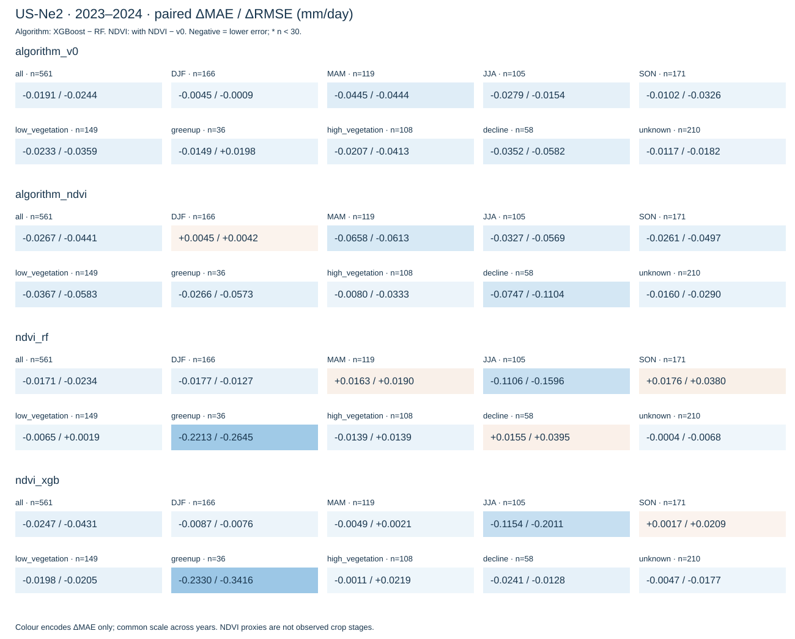
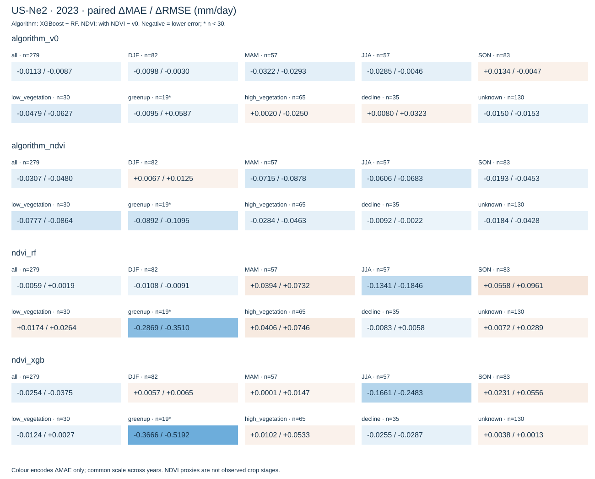
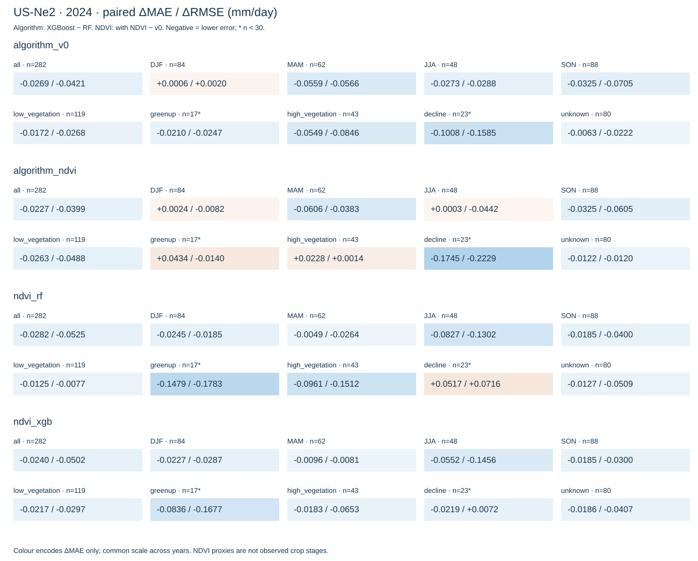

# Итоговый отчёт фазы 4 — коррекция остатка FAO-56

US-Ne2, тест 2023–2024, n=561. Минимальная общая MAE: Hybrid + NDVI XGBoost, 0.387753 мм/день. Это описательный результат на сохранённой тестовой выборке, не доказательство статистического превосходства.

**Статус фазы 4: complete_for_agreed_proxy_scope.** По решению пользователя от 03.11.2026 используются сезонный анализ и уже зафиксированные NDVI-фазы. Это уточнение исходного growth-stage analysis: NDVI-фазы — приближённые состояния растительности, а не подтверждённые агрономические стадии. Полевые записи не являются условием завершения согласованного объёма. NDVI-фаза определена для 351/561 дней; остальные сохранены как unknown. Статус и покрытие по годам: `phase4_readiness.json`.

## Протокол

Оценивается итоговая ET = FAO-56 ET₀ + прогноз остатка, а не остаток сам по себе. RF и XGBoost сравниваются внутри одинаковых наборов признаков; соответствие проверяется по метаданным. Четыре гибрида используют одинаковые даты и наблюдения. Семь исходных файлов проверяются общим загрузчиком. Никакое пересечение с молчаливой потерей дат не допускается.

Метрики пересчитаны из сохранённых прогнозов полной точности; округлённые итоговые CSV не используются как вход. Основная метрика — MAE. RMSE сильнее реагирует на крупные ошибки. Bias = mean(pred − obs); его улучшение оценивается по |bias|, а не по уменьшению знакового значения. Pearson r² — квадрат корреляции, R² = NSE. KGE учитывает корреляцию r, отношение стандартных отклонений α и отношение средних β: KGE = 1 − sqrt((r−1)²+(α−1)²+(β−1)²). Идеал каждого компонента — 1.

Разности: XGBoost − RF внутри версии; NDVI − v0 внутри алгоритма. Для MAE/RMSE/|bias| меньше лучше, для KGE/NSE/R² больше лучше. Знак Δbias сам по себе не задаёт победителя. Общий результат рассчитывается по всем датам, не усреднением групповых метрик. n < 30 — предупреждение о малой группе, не порог значимости. N/A означает неопределённую метрику; CSV содержит причины (пустая группа, недостаточно пар, постоянные значения или нулевое среднее наблюдений).

Признаки v0: tmax_c, tmin_c, rh_mean_pct, ws_ms, rn_mj_m2_day, p_kpa, precip_mm, doy. NDVI добавляет ndvi_last и ndvi_age_days. Сравнение NDVI отражает версии с отдельным обучением и подбором параметров на train/CV, а не изолированный причинный эффект двух признаков при фиксированных параметрах.

## Итоговая таблица

| model | n | mae | rmse | bias | pearson_r2 | r2_score | nse | kge | abs_bias |
| --- | --- | --- | --- | --- | --- | --- | --- | --- | --- |
| hybrid_rf | 561 | 0.4316 | 0.6244 | 0.1039 | 0.8631 | 0.8525 | 0.8525 | 0.8990 | 0.1039 |
| hybrid_xgb | 561 | 0.4124 | 0.6001 | 0.0878 | 0.8726 | 0.8638 | 0.8638 | 0.9102 | 0.0878 |
| hybrid_ndvi_rf | 561 | 0.4145 | 0.6010 | 0.1130 | 0.8742 | 0.8633 | 0.8633 | 0.8982 | 0.1130 |
| hybrid_ndvi_xgb | 561 | 0.3878 | 0.5569 | 0.1069 | 0.8950 | 0.8827 | 0.8827 | 0.9024 | 0.1069 |

## Общие разности и компромиссы

| comparison | n | delta_mae | delta_rmse | delta_bias | delta_pearson_r2 | delta_r2_score | delta_nse | delta_kge | delta_abs_bias |
| --- | --- | --- | --- | --- | --- | --- | --- | --- | --- |
| algorithm_v0 | 561 | -0.0191 | -0.0244 | -0.0161 | 0.0095 | 0.0113 | 0.0113 | 0.0111 | -0.0161 |
| algorithm_ndvi | 561 | -0.0267 | -0.0441 | -0.0061 | 0.0208 | 0.0193 | 0.0193 | 0.0042 | -0.0061 |
| ndvi_rf | 561 | -0.0171 | -0.0234 | 0.0091 | 0.0110 | 0.0109 | 0.0109 | -0.0008 | 0.0091 |
| ndvi_xgb | 561 | -0.0247 | -0.0431 | 0.0191 | 0.0224 | 0.0189 | 0.0189 | -0.0078 | 0.0191 |

| model | kge_r | kge_alpha | kge_beta | kge |
| --- | --- | --- | --- | --- |
| hybrid_rf | 0.9290 | 1.0100 | 1.0712 | 0.8990 |
| hybrid_xgb | 0.9341 | 1.0108 | 1.0601 | 0.9102 |
| hybrid_ndvi_rf | 0.9350 | 1.0124 | 1.0774 | 0.8982 |
| hybrid_ndvi_xgb | 0.9460 | 1.0355 | 1.0732 | 0.9024 |

- algorithm_v0: ΔMAE=-0.019145, ΔRMSE=-0.024383, Δbias=-0.016087, Δ|bias|=-0.016087, ΔKGE=+0.011132. Меньшая MAE: hybrid_xgb.
- algorithm_ndvi: ΔMAE=-0.026705, ΔRMSE=-0.044120, Δbias=-0.006098, Δ|bias|=-0.006098, ΔKGE=+0.004195. Меньшая MAE: hybrid_ndvi_xgb.
- ndvi_rf: ΔMAE=-0.017128, ΔRMSE=-0.023412, Δbias=+0.009077, Δ|bias|=+0.009077, ΔKGE=-0.000843. Меньшая MAE: hybrid_ndvi_rf.
- ndvi_xgb: ΔMAE=-0.024688, ΔRMSE=-0.043149, Δbias=+0.019066, Δ|bias|=+0.019066, ΔKGE=-0.007780. Меньшая MAE: hybrid_ndvi_xgb.

### Что меняется между алгоритмами и при добавлении NDVI

- Hybrid v0 XGBoost относительно Hybrid v0 RF: изменение MAE -4.44%. Корреляция r 0.9290 → 0.9341; отклонение α от 1: 0.0100 → 0.0108; отклонение β от 1: 0.0712 → 0.0601.
- Hybrid + NDVI XGBoost относительно Hybrid + NDVI RF: изменение MAE -6.44%. Корреляция r 0.9350 → 0.9460; отклонение α от 1: 0.0124 → 0.0355; отклонение β от 1: 0.0774 → 0.0732.
- Hybrid + NDVI RF относительно Hybrid v0 RF: изменение MAE -3.97%. Корреляция r 0.9290 → 0.9350; отклонение α от 1: 0.0100 → 0.0124; отклонение β от 1: 0.0712 → 0.0774.
- Hybrid + NDVI XGBoost относительно Hybrid v0 XGBoost: изменение MAE -5.99%. Корреляция r 0.9341 → 0.9460; отклонение α от 1: 0.0108 → 0.0355; отклонение β от 1: 0.0601 → 0.0732.

Наибольший KGE среди вариантов с определённой метрикой имеет Hybrid v0 XGBoost. Таким образом, выбор по KGE может отличаться от выбора по MAE/RMSE.

- algorithm_v0, season, объединённые годы: меньшая MAE левой модели в DJF, MAM, JJA, SON; большая в none; равная в none.
- algorithm_ndvi, season, объединённые годы: меньшая MAE левой модели в MAM, JJA, SON; большая в DJF; равная в none.
- ndvi_rf, season, объединённые годы: меньшая MAE левой модели в DJF, JJA; большая в MAM, SON; равная в none.
- ndvi_xgb, season, объединённые годы: меньшая MAE левой модели в DJF, MAM, JJA; большая в SON; равная в none.
- algorithm_v0, proxy_stage, объединённые годы: меньшая MAE левой модели в proxy_low_vegetation, proxy_greenup, proxy_high_vegetation, proxy_decline, unknown; большая в none; равная в none.
- algorithm_ndvi, proxy_stage, объединённые годы: меньшая MAE левой модели в proxy_low_vegetation, proxy_greenup, proxy_high_vegetation, proxy_decline, unknown; большая в none; равная в none.
- ndvi_rf, proxy_stage, объединённые годы: меньшая MAE левой модели в proxy_low_vegetation, proxy_greenup, proxy_high_vegetation, unknown; большая в proxy_decline; равная в none.
- ndvi_xgb, proxy_stage, объединённые годы: меньшая MAE левой модели в proxy_low_vegetation, proxy_greenup, proxy_high_vegetation, proxy_decline, unknown; большая в none; равная в none.

Снижение абсолютных ошибок не гарантирует улучшения KGE: компоненты среднего и разброса могут удаляться от 1 даже при росте корреляции. Для каждого сравнения компоненты и их разности сохранены в CSV. Выбор лучшего алгоритма здесь относится к MAE; он не означает превосходства по всем критериям.

## Устойчивость по сезонам и NDVI-фазам

В таблицах better/worse означает преимущество/ухудшение левой модели сравнения (XGBoost либо версия с NDVI). Число выигранных групп не заменяет общую метрику: группы различаются по числу дат и уровню ET. DJF объединяет январь, февраль и декабрь календарного года; полные зимние сезоны не реконструируются.

### 2023–2024



| dimension | comparison | metric | better_groups | worse_groups | tied_groups | undefined_groups |
| --- | --- | --- | --- | --- | --- | --- |
| season | algorithm_v0 | mae | DJF, MAM, JJA, SON | none | none | none |
| season | algorithm_v0 | rmse | DJF, MAM, JJA, SON | none | none | none |
| season | algorithm_v0 | abs_bias | DJF, MAM, JJA, SON | none | none | none |
| season | algorithm_v0 | kge | MAM, JJA, SON | DJF | none | none |
| season | algorithm_ndvi | mae | MAM, JJA, SON | DJF | none | none |
| season | algorithm_ndvi | rmse | MAM, JJA, SON | DJF | none | none |
| season | algorithm_ndvi | abs_bias | MAM, SON | DJF, JJA | none | none |
| season | algorithm_ndvi | kge | MAM, JJA, SON | DJF | none | none |
| season | ndvi_rf | mae | DJF, JJA | MAM, SON | none | none |
| season | ndvi_rf | rmse | DJF, JJA | MAM, SON | none | none |
| season | ndvi_rf | abs_bias | DJF, JJA | MAM, SON | none | none |
| season | ndvi_rf | kge | DJF, MAM, JJA | SON | none | none |
| season | ndvi_xgb | mae | DJF, MAM, JJA | SON | none | none |
| season | ndvi_xgb | rmse | DJF, JJA | MAM, SON | none | none |
| season | ndvi_xgb | abs_bias | none | DJF, MAM, JJA, SON | none | none |
| season | ndvi_xgb | kge | DJF, MAM, JJA | SON | none | none |
| proxy_stage | algorithm_v0 | mae | proxy_low_vegetation, proxy_greenup, proxy_high_vegetation, proxy_decline, unknown | none | none | none |
| proxy_stage | algorithm_v0 | rmse | proxy_low_vegetation, proxy_high_vegetation, proxy_decline, unknown | proxy_greenup | none | none |
| proxy_stage | algorithm_v0 | abs_bias | proxy_low_vegetation, proxy_decline | proxy_greenup, proxy_high_vegetation, unknown | none | none |
| proxy_stage | algorithm_v0 | kge | proxy_low_vegetation, proxy_high_vegetation, proxy_decline, unknown | proxy_greenup | none | none |
| proxy_stage | algorithm_ndvi | mae | proxy_low_vegetation, proxy_greenup, proxy_high_vegetation, proxy_decline, unknown | none | none | none |
| proxy_stage | algorithm_ndvi | rmse | proxy_low_vegetation, proxy_greenup, proxy_high_vegetation, proxy_decline, unknown | none | none | none |
| proxy_stage | algorithm_ndvi | abs_bias | proxy_low_vegetation, proxy_decline | proxy_greenup, proxy_high_vegetation, unknown | none | none |
| proxy_stage | algorithm_ndvi | kge | proxy_low_vegetation, proxy_greenup, proxy_high_vegetation, proxy_decline, unknown | none | none | none |
| proxy_stage | ndvi_rf | mae | proxy_low_vegetation, proxy_greenup, proxy_high_vegetation, unknown | proxy_decline | none | none |
| proxy_stage | ndvi_rf | rmse | proxy_greenup, unknown | proxy_low_vegetation, proxy_high_vegetation, proxy_decline | none | none |
| proxy_stage | ndvi_rf | abs_bias | proxy_low_vegetation, proxy_greenup | proxy_high_vegetation, proxy_decline, unknown | none | none |
| proxy_stage | ndvi_rf | kge | proxy_low_vegetation, proxy_greenup, unknown | proxy_high_vegetation, proxy_decline | none | none |
| proxy_stage | ndvi_xgb | mae | proxy_low_vegetation, proxy_greenup, proxy_high_vegetation, proxy_decline, unknown | none | none | none |
| proxy_stage | ndvi_xgb | rmse | proxy_low_vegetation, proxy_greenup, proxy_decline, unknown | proxy_high_vegetation | none | none |
| proxy_stage | ndvi_xgb | abs_bias | proxy_low_vegetation | proxy_greenup, proxy_high_vegetation, proxy_decline, unknown | none | none |
| proxy_stage | ndvi_xgb | kge | proxy_low_vegetation, proxy_greenup, proxy_decline, unknown | proxy_high_vegetation | none | none |

Разности основных показателей (все метрики доступны в CSV):

| dimension | group | comparison | n | small_group | delta_mae | delta_rmse | delta_bias | delta_abs_bias | delta_kge |
| --- | --- | --- | --- | --- | --- | --- | --- | --- | --- |
| overall | all | algorithm_v0 | 561 | False | -0.0191 | -0.0244 | -0.0161 | -0.0161 | 0.0111 |
| overall | all | algorithm_ndvi | 561 | False | -0.0267 | -0.0441 | -0.0061 | -0.0061 | 0.0042 |
| overall | all | ndvi_rf | 561 | False | -0.0171 | -0.0234 | 0.0091 | 0.0091 | -0.0008 |
| overall | all | ndvi_xgb | 561 | False | -0.0247 | -0.0431 | 0.0191 | 0.0191 | -0.0078 |
| season | DJF | algorithm_v0 | 166 | False | -0.0045 | -0.0009 | -0.0054 | -0.0054 | -0.0046 |
| season | DJF | algorithm_ndvi | 166 | False | 0.0045 | 0.0042 | -0.0134 | 0.0134 | -0.0190 |
| season | DJF | ndvi_rf | 166 | False | -0.0177 | -0.0127 | -0.0276 | -0.0162 | 0.0325 |
| season | DJF | ndvi_xgb | 166 | False | -0.0087 | -0.0076 | -0.0356 | 0.0026 | 0.0181 |
| season | MAM | algorithm_v0 | 119 | False | -0.0445 | -0.0444 | -0.0203 | -0.0203 | 0.0766 |
| season | MAM | algorithm_ndvi | 119 | False | -0.0658 | -0.0613 | -0.0379 | -0.0379 | 0.0806 |
| season | MAM | ndvi_rf | 119 | False | 0.0163 | 0.0190 | 0.0221 | 0.0221 | 0.0112 |
| season | MAM | ndvi_xgb | 119 | False | -0.0049 | 0.0021 | 0.0045 | 0.0045 | 0.0152 |
| season | JJA | algorithm_v0 | 105 | False | -0.0279 | -0.0154 | -0.0071 | -0.0071 | 0.0080 |
| season | JJA | algorithm_ndvi | 105 | False | -0.0327 | -0.0569 | 0.0795 | 0.0795 | 0.0153 |
| season | JJA | ndvi_rf | 105 | False | -0.1106 | -0.1596 | -0.0095 | -0.0095 | 0.0575 |
| season | JJA | ndvi_xgb | 105 | False | -0.1154 | -0.2011 | 0.0772 | 0.0772 | 0.0648 |
| season | SON | algorithm_v0 | 171 | False | -0.0102 | -0.0326 | -0.0290 | -0.0290 | 0.0197 |
| season | SON | algorithm_ndvi | 171 | False | -0.0261 | -0.0497 | -0.0294 | -0.0294 | 0.0157 |
| season | SON | ndvi_rf | 171 | False | 0.0176 | 0.0380 | 0.0470 | 0.0470 | -0.0387 |
| season | SON | ndvi_xgb | 171 | False | 0.0017 | 0.0209 | 0.0467 | 0.0467 | -0.0427 |
| proxy_stage | proxy_low_vegetation | algorithm_v0 | 149 | False | -0.0233 | -0.0359 | -0.0234 | -0.0234 | 0.0562 |
| proxy_stage | proxy_low_vegetation | algorithm_ndvi | 149 | False | -0.0367 | -0.0583 | -0.0386 | -0.0386 | 0.0797 |
| proxy_stage | proxy_low_vegetation | ndvi_rf | 149 | False | -0.0065 | 0.0019 | -0.0296 | -0.0296 | 0.0287 |
| proxy_stage | proxy_low_vegetation | ndvi_xgb | 149 | False | -0.0198 | -0.0205 | -0.0448 | -0.0448 | 0.0523 |
| proxy_stage | proxy_greenup | algorithm_v0 | 36 | False | -0.0149 | 0.0198 | -0.0322 | 0.0322 | -0.0106 |
| proxy_stage | proxy_greenup | algorithm_ndvi | 36 | False | -0.0266 | -0.0573 | 0.1325 | 0.1325 | 0.0245 |
| proxy_stage | proxy_greenup | ndvi_rf | 36 | False | -0.2213 | -0.2645 | 0.0908 | -0.0637 | 0.1357 |
| proxy_stage | proxy_greenup | ndvi_xgb | 36 | False | -0.2330 | -0.3416 | 0.2554 | 0.0366 | 0.1709 |
| proxy_stage | proxy_high_vegetation | algorithm_v0 | 108 | False | -0.0207 | -0.0413 | 0.0078 | 0.0078 | 0.0028 |
| proxy_stage | proxy_high_vegetation | algorithm_ndvi | 108 | False | -0.0080 | -0.0333 | 0.0203 | 0.0203 | 0.0222 |
| proxy_stage | proxy_high_vegetation | ndvi_rf | 108 | False | -0.0139 | 0.0139 | 0.0611 | 0.0611 | -0.0247 |
| proxy_stage | proxy_high_vegetation | ndvi_xgb | 108 | False | -0.0011 | 0.0219 | 0.0736 | 0.0736 | -0.0053 |
| proxy_stage | proxy_decline | algorithm_v0 | 58 | False | -0.0352 | -0.0582 | -0.0831 | -0.0831 | 0.0532 |
| proxy_stage | proxy_decline | algorithm_ndvi | 58 | False | -0.0747 | -0.1104 | -0.0746 | -0.0746 | 0.1717 |
| proxy_stage | proxy_decline | ndvi_rf | 58 | False | 0.0155 | 0.0395 | 0.0227 | 0.0227 | -0.0779 |
| proxy_stage | proxy_decline | ndvi_xgb | 58 | False | -0.0241 | -0.0128 | 0.0313 | 0.0313 | 0.0406 |
| proxy_stage | unknown | algorithm_v0 | 210 | False | -0.0117 | -0.0182 | -0.0019 | 0.0019 | 0.0131 |
| proxy_stage | unknown | algorithm_ndvi | 210 | False | -0.0160 | -0.0290 | -0.0015 | 0.0015 | 0.0271 |
| proxy_stage | unknown | ndvi_rf | 210 | False | -0.0004 | -0.0068 | -0.0080 | 0.0080 | 0.0002 |
| proxy_stage | unknown | ndvi_xgb | 210 | False | -0.0047 | -0.0177 | -0.0076 | 0.0076 | 0.0142 |

### 2023



| dimension | comparison | metric | better_groups | worse_groups | tied_groups | undefined_groups |
| --- | --- | --- | --- | --- | --- | --- |
| season | algorithm_v0 | mae | DJF, MAM, JJA | SON | none | none |
| season | algorithm_v0 | rmse | DJF, MAM, JJA, SON | none | none | none |
| season | algorithm_v0 | abs_bias | DJF, MAM, JJA, SON | none | none | none |
| season | algorithm_v0 | kge | MAM, JJA, SON | DJF | none | none |
| season | algorithm_ndvi | mae | MAM, JJA, SON | DJF | none | none |
| season | algorithm_ndvi | rmse | MAM, JJA, SON | DJF | none | none |
| season | algorithm_ndvi | abs_bias | MAM, JJA, SON | DJF | none | none |
| season | algorithm_ndvi | kge | MAM, JJA, SON | DJF | none | none |
| season | ndvi_rf | mae | DJF, JJA | MAM, SON | none | none |
| season | ndvi_rf | rmse | DJF, JJA | MAM, SON | none | none |
| season | ndvi_rf | abs_bias | JJA | DJF, MAM, SON | none | none |
| season | ndvi_rf | kge | DJF, MAM, JJA | SON | none | none |
| season | ndvi_xgb | mae | JJA | DJF, MAM, SON | none | none |
| season | ndvi_xgb | rmse | JJA | DJF, MAM, SON | none | none |
| season | ndvi_xgb | abs_bias | JJA | DJF, MAM, SON | none | none |
| season | ndvi_xgb | kge | DJF, MAM, JJA | SON | none | none |
| proxy_stage | algorithm_v0 | mae | proxy_low_vegetation, proxy_greenup, unknown | proxy_high_vegetation, proxy_decline | none | none |
| proxy_stage | algorithm_v0 | rmse | proxy_low_vegetation, proxy_high_vegetation, unknown | proxy_greenup, proxy_decline | none | none |
| proxy_stage | algorithm_v0 | abs_bias | proxy_low_vegetation, proxy_decline, unknown | proxy_greenup, proxy_high_vegetation | none | none |
| proxy_stage | algorithm_v0 | kge | proxy_low_vegetation, unknown | proxy_greenup, proxy_high_vegetation, proxy_decline | none | none |
| proxy_stage | algorithm_ndvi | mae | proxy_low_vegetation, proxy_greenup, proxy_high_vegetation, proxy_decline, unknown | none | none | none |
| proxy_stage | algorithm_ndvi | rmse | proxy_low_vegetation, proxy_greenup, proxy_high_vegetation, proxy_decline, unknown | none | none | none |
| proxy_stage | algorithm_ndvi | abs_bias | proxy_low_vegetation, proxy_greenup, proxy_high_vegetation, proxy_decline, unknown | none | none | none |
| proxy_stage | algorithm_ndvi | kge | proxy_low_vegetation, proxy_greenup, proxy_high_vegetation, proxy_decline, unknown | none | none | none |
| proxy_stage | ndvi_rf | mae | proxy_greenup, proxy_decline | proxy_low_vegetation, proxy_high_vegetation, unknown | none | none |
| proxy_stage | ndvi_rf | rmse | proxy_greenup | proxy_low_vegetation, proxy_high_vegetation, proxy_decline, unknown | none | none |
| proxy_stage | ndvi_rf | abs_bias | proxy_low_vegetation, proxy_greenup, proxy_decline, unknown | proxy_high_vegetation | none | none |
| proxy_stage | ndvi_rf | kge | proxy_greenup, unknown | proxy_low_vegetation, proxy_high_vegetation, proxy_decline | none | none |
| proxy_stage | ndvi_xgb | mae | proxy_low_vegetation, proxy_greenup, proxy_decline | proxy_high_vegetation, unknown | none | none |
| proxy_stage | ndvi_xgb | rmse | proxy_greenup, proxy_decline | proxy_low_vegetation, proxy_high_vegetation, unknown | none | none |
| proxy_stage | ndvi_xgb | abs_bias | proxy_low_vegetation, proxy_greenup, unknown | proxy_high_vegetation, proxy_decline | none | none |
| proxy_stage | ndvi_xgb | kge | proxy_greenup, proxy_decline, unknown | proxy_low_vegetation, proxy_high_vegetation | none | none |

Разности основных показателей (все метрики доступны в CSV):

| dimension | group | comparison | n | small_group | delta_mae | delta_rmse | delta_bias | delta_abs_bias | delta_kge |
| --- | --- | --- | --- | --- | --- | --- | --- | --- | --- |
| overall | all | algorithm_v0 | 279 | False | -0.0113 | -0.0087 | -0.0090 | -0.0090 | 0.0044 |
| overall | all | algorithm_ndvi | 279 | False | -0.0307 | -0.0480 | -0.0076 | -0.0076 | 0.0060 |
| overall | all | ndvi_rf | 279 | False | -0.0059 | 0.0019 | 0.0404 | 0.0404 | -0.0182 |
| overall | all | ndvi_xgb | 279 | False | -0.0254 | -0.0375 | 0.0418 | 0.0418 | -0.0166 |
| season | DJF | algorithm_v0 | 82 | False | -0.0098 | -0.0030 | 0.0060 | -0.0060 | -0.0027 |
| season | DJF | algorithm_ndvi | 82 | False | 0.0067 | 0.0125 | -0.0144 | 0.0144 | -0.0078 |
| season | DJF | ndvi_rf | 82 | False | -0.0108 | -0.0091 | -0.0131 | 0.0131 | 0.0095 |
| season | DJF | ndvi_xgb | 82 | False | 0.0057 | 0.0065 | -0.0334 | 0.0334 | 0.0044 |
| season | MAM | algorithm_v0 | 57 | False | -0.0322 | -0.0293 | -0.0379 | -0.0379 | 0.0960 |
| season | MAM | algorithm_ndvi | 57 | False | -0.0715 | -0.0878 | -0.0635 | -0.0635 | 0.1182 |
| season | MAM | ndvi_rf | 57 | False | 0.0394 | 0.0732 | 0.0471 | 0.0471 | 0.0303 |
| season | MAM | ndvi_xgb | 57 | False | 0.0001 | 0.0147 | 0.0215 | 0.0215 | 0.0525 |
| season | JJA | algorithm_v0 | 57 | False | -0.0285 | -0.0046 | 0.0091 | -0.0091 | 0.0095 |
| season | JJA | algorithm_ndvi | 57 | False | -0.0606 | -0.0683 | 0.0858 | -0.0858 | 0.0307 |
| season | JJA | ndvi_rf | 57 | False | -0.1341 | -0.1846 | 0.0973 | -0.0973 | 0.0869 |
| season | JJA | ndvi_xgb | 57 | False | -0.1661 | -0.2483 | 0.1739 | -0.1739 | 0.1081 |
| season | SON | algorithm_v0 | 83 | False | 0.0134 | -0.0047 | -0.0164 | -0.0164 | 0.0088 |
| season | SON | algorithm_ndvi | 83 | False | -0.0193 | -0.0453 | -0.0267 | -0.0267 | 0.0234 |
| season | SON | ndvi_rf | 83 | False | 0.0558 | 0.0961 | 0.0497 | 0.0497 | -0.0584 |
| season | SON | ndvi_xgb | 83 | False | 0.0231 | 0.0556 | 0.0394 | 0.0394 | -0.0438 |
| proxy_stage | proxy_low_vegetation | algorithm_v0 | 30 | False | -0.0479 | -0.0627 | -0.0616 | -0.0616 | 0.1423 |
| proxy_stage | proxy_low_vegetation | algorithm_ndvi | 30 | False | -0.0777 | -0.0864 | -0.1123 | -0.1123 | 0.0850 |
| proxy_stage | proxy_low_vegetation | ndvi_rf | 30 | False | 0.0174 | 0.0264 | -0.0189 | -0.0189 | -0.0675 |
| proxy_stage | proxy_low_vegetation | ndvi_xgb | 30 | False | -0.0124 | 0.0027 | -0.0696 | -0.0696 | -0.1248 |
| proxy_stage | proxy_greenup | algorithm_v0 | 19 | True | -0.0095 | 0.0587 | -0.0189 | 0.0189 | -0.0199 |
| proxy_stage | proxy_greenup | algorithm_ndvi | 19 | True | -0.0892 | -0.1095 | 0.1611 | -0.1611 | 0.0252 |
| proxy_stage | proxy_greenup | ndvi_rf | 19 | True | -0.2869 | -0.3510 | 0.3351 | -0.3351 | 0.0971 |
| proxy_stage | proxy_greenup | ndvi_xgb | 19 | True | -0.3666 | -0.5192 | 0.5151 | -0.5151 | 0.1421 |
| proxy_stage | proxy_high_vegetation | algorithm_v0 | 65 | False | 0.0020 | -0.0250 | 0.0015 | 0.0015 | -0.0036 |
| proxy_stage | proxy_high_vegetation | algorithm_ndvi | 65 | False | -0.0284 | -0.0463 | -0.0284 | -0.0284 | 0.0257 |
| proxy_stage | proxy_high_vegetation | ndvi_rf | 65 | False | 0.0406 | 0.0746 | 0.0633 | 0.0633 | -0.0447 |
| proxy_stage | proxy_high_vegetation | ndvi_xgb | 65 | False | 0.0102 | 0.0533 | 0.0334 | 0.0334 | -0.0154 |
| proxy_stage | proxy_decline | algorithm_v0 | 35 | False | 0.0080 | 0.0323 | -0.0487 | -0.0168 | -0.0904 |
| proxy_stage | proxy_decline | algorithm_ndvi | 35 | False | -0.0092 | -0.0022 | -0.0054 | -0.0054 | 0.0606 |
| proxy_stage | proxy_decline | ndvi_rf | 35 | False | -0.0083 | 0.0058 | -0.0095 | -0.0095 | -0.0696 |
| proxy_stage | proxy_decline | ndvi_xgb | 35 | False | -0.0255 | -0.0287 | 0.0338 | 0.0019 | 0.0814 |
| proxy_stage | unknown | algorithm_v0 | 130 | False | -0.0150 | -0.0153 | 0.0100 | -0.0100 | 0.0386 |
| proxy_stage | unknown | algorithm_ndvi | 130 | False | -0.0184 | -0.0428 | 0.0016 | -0.0016 | 0.0652 |
| proxy_stage | unknown | ndvi_rf | 130 | False | 0.0072 | 0.0289 | 0.0131 | -0.0131 | 0.0516 |
| proxy_stage | unknown | ndvi_xgb | 130 | False | 0.0038 | 0.0013 | 0.0047 | -0.0047 | 0.0782 |

### 2024



| dimension | comparison | metric | better_groups | worse_groups | tied_groups | undefined_groups |
| --- | --- | --- | --- | --- | --- | --- |
| season | algorithm_v0 | mae | MAM, JJA, SON | DJF | none | none |
| season | algorithm_v0 | rmse | MAM, JJA, SON | DJF | none | none |
| season | algorithm_v0 | abs_bias | DJF, MAM, JJA | SON | none | none |
| season | algorithm_v0 | kge | MAM, JJA, SON | DJF | none | none |
| season | algorithm_ndvi | mae | MAM, SON | DJF, JJA | none | none |
| season | algorithm_ndvi | rmse | DJF, MAM, JJA, SON | none | none | none |
| season | algorithm_ndvi | abs_bias | DJF, MAM | JJA, SON | none | none |
| season | algorithm_ndvi | kge | MAM, JJA, SON | DJF | none | none |
| season | ndvi_rf | mae | DJF, MAM, JJA, SON | none | none | none |
| season | ndvi_rf | rmse | DJF, MAM, JJA, SON | none | none | none |
| season | ndvi_rf | abs_bias | DJF, MAM, JJA, SON | none | none | none |
| season | ndvi_rf | kge | DJF, MAM, JJA, SON | none | none | none |
| season | ndvi_xgb | mae | DJF, MAM, JJA, SON | none | none | none |
| season | ndvi_xgb | rmse | DJF, MAM, JJA, SON | none | none | none |
| season | ndvi_xgb | abs_bias | DJF, MAM, JJA, SON | none | none | none |
| season | ndvi_xgb | kge | DJF, MAM, JJA, SON | none | none | none |
| proxy_stage | algorithm_v0 | mae | proxy_low_vegetation, proxy_greenup, proxy_high_vegetation, proxy_decline, unknown | none | none | none |
| proxy_stage | algorithm_v0 | rmse | proxy_low_vegetation, proxy_greenup, proxy_high_vegetation, proxy_decline, unknown | none | none | none |
| proxy_stage | algorithm_v0 | abs_bias | proxy_low_vegetation, proxy_greenup, proxy_high_vegetation, proxy_decline, unknown | none | none | none |
| proxy_stage | algorithm_v0 | kge | proxy_low_vegetation, proxy_greenup, proxy_high_vegetation, proxy_decline, unknown | none | none | none |
| proxy_stage | algorithm_ndvi | mae | proxy_low_vegetation, proxy_decline, unknown | proxy_greenup, proxy_high_vegetation | none | none |
| proxy_stage | algorithm_ndvi | rmse | proxy_low_vegetation, proxy_greenup, proxy_decline, unknown | proxy_high_vegetation | none | none |
| proxy_stage | algorithm_ndvi | abs_bias | proxy_low_vegetation, proxy_high_vegetation, proxy_decline, unknown | proxy_greenup | none | none |
| proxy_stage | algorithm_ndvi | kge | proxy_low_vegetation, proxy_greenup, proxy_decline, unknown | proxy_high_vegetation | none | none |
| proxy_stage | ndvi_rf | mae | proxy_low_vegetation, proxy_greenup, proxy_high_vegetation, unknown | proxy_decline | none | none |
| proxy_stage | ndvi_rf | rmse | proxy_low_vegetation, proxy_greenup, proxy_high_vegetation, unknown | proxy_decline | none | none |
| proxy_stage | ndvi_rf | abs_bias | proxy_low_vegetation, proxy_greenup, proxy_high_vegetation, unknown | proxy_decline | none | none |
| proxy_stage | ndvi_rf | kge | proxy_low_vegetation, proxy_greenup, proxy_high_vegetation, unknown | proxy_decline | none | none |
| proxy_stage | ndvi_xgb | mae | proxy_low_vegetation, proxy_greenup, proxy_high_vegetation, proxy_decline, unknown | none | none | none |
| proxy_stage | ndvi_xgb | rmse | proxy_low_vegetation, proxy_greenup, proxy_high_vegetation, unknown | proxy_decline | none | none |
| proxy_stage | ndvi_xgb | abs_bias | proxy_low_vegetation, proxy_greenup, proxy_high_vegetation, unknown | proxy_decline | none | none |
| proxy_stage | ndvi_xgb | kge | proxy_low_vegetation, proxy_greenup, unknown | proxy_high_vegetation, proxy_decline | none | none |

Разности основных показателей (все метрики доступны в CSV):

| dimension | group | comparison | n | small_group | delta_mae | delta_rmse | delta_bias | delta_abs_bias | delta_kge |
| --- | --- | --- | --- | --- | --- | --- | --- | --- | --- |
| overall | all | algorithm_v0 | 282 | False | -0.0269 | -0.0421 | -0.0231 | -0.0231 | 0.0182 |
| overall | all | algorithm_ndvi | 282 | False | -0.0227 | -0.0399 | -0.0046 | -0.0046 | 0.0053 |
| overall | all | ndvi_rf | 282 | False | -0.0282 | -0.0525 | -0.0220 | -0.0220 | 0.0179 |
| overall | all | ndvi_xgb | 282 | False | -0.0240 | -0.0502 | -0.0035 | -0.0035 | 0.0050 |
| season | DJF | algorithm_v0 | 84 | False | 0.0006 | 0.0020 | -0.0164 | -0.0164 | -0.0007 |
| season | DJF | algorithm_ndvi | 84 | False | 0.0024 | -0.0082 | -0.0125 | -0.0125 | -0.0022 |
| season | DJF | ndvi_rf | 84 | False | -0.0245 | -0.0185 | -0.0418 | -0.0418 | 0.0874 |
| season | DJF | ndvi_xgb | 84 | False | -0.0227 | -0.0287 | -0.0378 | -0.0378 | 0.0859 |
| season | MAM | algorithm_v0 | 62 | False | -0.0559 | -0.0566 | -0.0042 | -0.0042 | 0.0658 |
| season | MAM | algorithm_ndvi | 62 | False | -0.0606 | -0.0383 | -0.0144 | -0.0144 | 0.0575 |
| season | MAM | ndvi_rf | 62 | False | -0.0049 | -0.0264 | -0.0010 | -0.0010 | 0.0127 |
| season | MAM | ndvi_xgb | 62 | False | -0.0096 | -0.0081 | -0.0112 | -0.0112 | 0.0044 |
| season | JJA | algorithm_v0 | 48 | False | -0.0273 | -0.0288 | -0.0264 | -0.0264 | 0.0064 |
| season | JJA | algorithm_ndvi | 48 | False | 0.0003 | -0.0442 | 0.0721 | 0.0721 | 0.0078 |
| season | JJA | ndvi_rf | 48 | False | -0.0827 | -0.1302 | -0.1362 | -0.1362 | 0.0330 |
| season | JJA | ndvi_xgb | 48 | False | -0.0552 | -0.1456 | -0.0377 | -0.0377 | 0.0344 |
| season | SON | algorithm_v0 | 88 | False | -0.0325 | -0.0705 | -0.0409 | 0.0409 | 0.0192 |
| season | SON | algorithm_ndvi | 88 | False | -0.0325 | -0.0605 | -0.0320 | 0.0320 | 0.0403 |
| season | SON | ndvi_rf | 88 | False | -0.0185 | -0.0400 | 0.0445 | -0.0445 | 0.0511 |
| season | SON | ndvi_xgb | 88 | False | -0.0185 | -0.0300 | 0.0535 | -0.0535 | 0.0722 |
| proxy_stage | proxy_low_vegetation | algorithm_v0 | 119 | False | -0.0172 | -0.0268 | -0.0138 | -0.0138 | 0.0355 |
| proxy_stage | proxy_low_vegetation | algorithm_ndvi | 119 | False | -0.0263 | -0.0488 | -0.0200 | -0.0200 | 0.0465 |
| proxy_stage | proxy_low_vegetation | ndvi_rf | 119 | False | -0.0125 | -0.0077 | -0.0323 | -0.0323 | 0.0470 |
| proxy_stage | proxy_low_vegetation | ndvi_xgb | 119 | False | -0.0217 | -0.0297 | -0.0385 | -0.0385 | 0.0579 |
| proxy_stage | proxy_greenup | algorithm_v0 | 17 | True | -0.0210 | -0.0247 | -0.0471 | -0.0471 | 0.0163 |
| proxy_stage | proxy_greenup | algorithm_ndvi | 17 | True | 0.0434 | -0.0140 | 0.1005 | 0.1005 | 0.0507 |
| proxy_stage | proxy_greenup | ndvi_rf | 17 | True | -0.1479 | -0.1783 | -0.1824 | -0.1824 | 0.0107 |
| proxy_stage | proxy_greenup | ndvi_xgb | 17 | True | -0.0836 | -0.1677 | -0.0348 | -0.0348 | 0.0450 |
| proxy_stage | proxy_high_vegetation | algorithm_v0 | 43 | False | -0.0549 | -0.0846 | 0.0173 | -0.0173 | 0.0176 |
| proxy_stage | proxy_high_vegetation | algorithm_ndvi | 43 | False | 0.0228 | 0.0014 | 0.0938 | -0.0938 | -0.0185 |
| proxy_stage | proxy_high_vegetation | ndvi_rf | 43 | False | -0.0961 | -0.1512 | 0.0579 | -0.0579 | 0.0330 |
| proxy_stage | proxy_high_vegetation | ndvi_xgb | 43 | False | -0.0183 | -0.0653 | 0.1343 | -0.1343 | -0.0032 |
| proxy_stage | proxy_decline | algorithm_v0 | 23 | True | -0.1008 | -0.1585 | -0.1356 | -0.1356 | 0.4426 |
| proxy_stage | proxy_decline | algorithm_ndvi | 23 | True | -0.1745 | -0.2229 | -0.1799 | -0.1799 | 0.6390 |
| proxy_stage | proxy_decline | ndvi_rf | 23 | True | 0.0517 | 0.0716 | 0.0718 | 0.0718 | -0.2001 |
| proxy_stage | proxy_decline | ndvi_xgb | 23 | True | -0.0219 | 0.0072 | 0.0275 | 0.0275 | -0.0038 |
| proxy_stage | unknown | algorithm_v0 | 80 | False | -0.0063 | -0.0222 | -0.0212 | -0.0212 | 0.0177 |
| proxy_stage | unknown | algorithm_ndvi | 80 | False | -0.0122 | -0.0120 | -0.0064 | -0.0064 | 0.0060 |
| proxy_stage | unknown | ndvi_rf | 80 | False | -0.0127 | -0.0509 | -0.0423 | -0.0423 | 0.0449 |
| proxy_stage | unknown | ndvi_xgb | 80 | False | -0.0186 | -0.0407 | -0.0276 | -0.0276 | 0.0332 |

## Покрытие, культура и неизвестные стадии

| period | dimension | group | n | small_group | crop_context | share | proxy_unknown_n | actual_unknown_n | actual_observed_n |
| --- | --- | --- | --- | --- | --- | --- | --- | --- | --- |
| 2023–2024 | overall | all | 561 | False | 2023/maize/inferred_rotation: 279; 2024/soybean/inferred_rotation: 282 | 1.0000 | 210 | 561 | 0 |
| 2023–2024 | season | DJF | 166 | False | 2023/maize/inferred_rotation: 82; 2024/soybean/inferred_rotation: 84 | 0.2959 | 98 | 166 | 0 |
| 2023–2024 | season | MAM | 119 | False | 2023/maize/inferred_rotation: 57; 2024/soybean/inferred_rotation: 62 | 0.2121 | 45 | 119 | 0 |
| 2023–2024 | season | JJA | 105 | False | 2023/maize/inferred_rotation: 57; 2024/soybean/inferred_rotation: 48 | 0.1872 | 18 | 105 | 0 |
| 2023–2024 | season | SON | 171 | False | 2023/maize/inferred_rotation: 83; 2024/soybean/inferred_rotation: 88 | 0.3048 | 49 | 171 | 0 |
| 2023–2024 | proxy_stage | proxy_low_vegetation | 149 | False | 2023/maize/inferred_rotation: 30; 2024/soybean/inferred_rotation: 119 | 0.2656 | 0 | 149 | 0 |
| 2023–2024 | proxy_stage | proxy_greenup | 36 | False | 2023/maize/inferred_rotation: 19; 2024/soybean/inferred_rotation: 17 | 0.0642 | 0 | 36 | 0 |
| 2023–2024 | proxy_stage | proxy_high_vegetation | 108 | False | 2023/maize/inferred_rotation: 65; 2024/soybean/inferred_rotation: 43 | 0.1925 | 0 | 108 | 0 |
| 2023–2024 | proxy_stage | proxy_decline | 58 | False | 2023/maize/inferred_rotation: 35; 2024/soybean/inferred_rotation: 23 | 0.1034 | 0 | 58 | 0 |
| 2023–2024 | proxy_stage | unknown | 210 | False | 2023/maize/inferred_rotation: 130; 2024/soybean/inferred_rotation: 80 | 0.3743 | 210 | 210 | 0 |
| 2023 | overall | all | 279 | False | 2023/maize/inferred_rotation: 279 | 1.0000 | 130 | 279 | 0 |
| 2023 | season | DJF | 82 | False | 2023/maize/inferred_rotation: 82 | 0.2939 | 82 | 82 | 0 |
| 2023 | season | MAM | 57 | False | 2023/maize/inferred_rotation: 57 | 0.2043 | 27 | 57 | 0 |
| 2023 | season | JJA | 57 | False | 2023/maize/inferred_rotation: 57 | 0.2043 | 4 | 57 | 0 |
| 2023 | season | SON | 83 | False | 2023/maize/inferred_rotation: 83 | 0.2975 | 17 | 83 | 0 |
| 2023 | proxy_stage | proxy_low_vegetation | 30 | False | 2023/maize/inferred_rotation: 30 | 0.1075 | 0 | 30 | 0 |
| 2023 | proxy_stage | proxy_greenup | 19 | True | 2023/maize/inferred_rotation: 19 | 0.0681 | 0 | 19 | 0 |
| 2023 | proxy_stage | proxy_high_vegetation | 65 | False | 2023/maize/inferred_rotation: 65 | 0.2330 | 0 | 65 | 0 |
| 2023 | proxy_stage | proxy_decline | 35 | False | 2023/maize/inferred_rotation: 35 | 0.1254 | 0 | 35 | 0 |
| 2023 | proxy_stage | unknown | 130 | False | 2023/maize/inferred_rotation: 130 | 0.4659 | 130 | 130 | 0 |
| 2024 | overall | all | 282 | False | 2024/soybean/inferred_rotation: 282 | 1.0000 | 80 | 282 | 0 |
| 2024 | season | DJF | 84 | False | 2024/soybean/inferred_rotation: 84 | 0.2979 | 16 | 84 | 0 |
| 2024 | season | MAM | 62 | False | 2024/soybean/inferred_rotation: 62 | 0.2199 | 18 | 62 | 0 |
| 2024 | season | JJA | 48 | False | 2024/soybean/inferred_rotation: 48 | 0.1702 | 14 | 48 | 0 |
| 2024 | season | SON | 88 | False | 2024/soybean/inferred_rotation: 88 | 0.3121 | 32 | 88 | 0 |
| 2024 | proxy_stage | proxy_low_vegetation | 119 | False | 2024/soybean/inferred_rotation: 119 | 0.4220 | 0 | 119 | 0 |
| 2024 | proxy_stage | proxy_greenup | 17 | True | 2024/soybean/inferred_rotation: 17 | 0.0603 | 0 | 17 | 0 |
| 2024 | proxy_stage | proxy_high_vegetation | 43 | False | 2024/soybean/inferred_rotation: 43 | 0.1525 | 0 | 43 | 0 |
| 2024 | proxy_stage | proxy_decline | 23 | True | 2024/soybean/inferred_rotation: 23 | 0.0816 | 0 | 23 | 0 |
| 2024 | proxy_stage | unknown | 80 | False | 2024/soybean/inferred_rotation: 80 | 0.2837 | 80 | 80 | 0 |

Unknown NDVI: 210/561 (37.43%). Неизвестные фактические стадии: 561/561; подтверждённые: 0. Unknown включён в метрики отдельной группой. Культуры и статусы в таблице получены из разметки; inferred_rotation означает предположение по севообороту, а не полевое подтверждение.

## Objective 4 — Seasonal and NDVI-derived vegetation-phase analysis

В согласованном объёме выполнены сезонный анализ и сравнение по фиксированным NDVI-фазам: низкая растительность, рост NDVI, высокая растительность, снижение NDVI и отдельная группа unknown. Правила разметки не подбирались по ошибкам holdout и в этой работе не менялись. Низкий NDVI не доказывает отсутствие культуры; высокий NDVI не устанавливает цветение. Фактические стадии остаются неподтверждёнными и не входят в критерий завершения выбранного варианта. Покрытие и малые группы по годам перечислены в phase4_readiness.json.

## Objective 5 — Random Forest vs XGBoost as residual-correction component

По общей MAE среди четырёх гибридов лучший результат у Hybrid + NDVI XGBoost. Попарные преимущества и исключения перечислены для каждой версии, сезона, NDVI-фазы и года. Вклад NDVI оценён отдельно для RF и XGBoost; вывод о пользе ограничен конкретными метриками, а не всеми показателями одновременно. Этот анализ не используется для повторной настройки по holdout.

## Ограничения

Одна станция US-Ne2 и тестовые годы 2023–2024. Статистическая значимость не проверялась; доверительные интервалы и причинные эффекты не заявляются. Даты серийно зависимы. Культура и год смешаны, а доступность ET/снимков и размеры групп неодинаковы: межгодовое изменение ошибки нельзя приписать одной фазе. Разметка и NDVI-гибриды используют связанный спутниковый сигнал, поэтому это не независимая проверка фенологии. FAO-56 даёт эталонную ET₀, а коррекция обучена относительно наблюдаемой фактической ET. Переносимость на Казахстан, другие станции и годы, водосбережение и качество решений о поливе не проверялись.

## Результаты и воспроизведение

- [Все метрики и KGE-компоненты](phase4_metrics.csv)
- [Все попарные разности](phase4_deltas.csv)
- [Устойчивость преимуществ](phase4_stability.csv)
- [Дополнительная диагностика фактических стадий (вне согласованного объёма)](phase4_actual_stage_metrics.csv)
- [Статус полноты и покрытие стадий](phase4_readiness.json)
- [Аудит дат](phase4_dates.csv) и [покрытие](phase4_coverage.csv)
- [Входы, метаданные и хеши кода](phase4_manifest.json)
- [Общее сравнение фазы 3](fao56_ml_comparison.md)
- [Сезонный анализ](seasonal_comparison.md)
- [Анализ по NDVI-фазам](phenology_comparison.md)
- [Проверка NDVI-гибридов](hybrid_ndvi_validation.md)

Из корня репозитория в установленном окружении:

```bash
PYTHONPATH=src python -m ml.evaluation.phase4
PYTHONPATH=src python -m pytest tests/test_phase4.py tests/test_phenology_evaluation.py -q
```

Дополнительное воспроизведение исходных анализов:

```bash
PYTHONPATH=src python -m ml.evaluation.compare_models --from-files
PYTHONPATH=src python -m ml.evaluation.seasonal
PYTHONPATH=src python -m ml.evaluation.phenology
```

Скрипт phase4 сам рассчитывает все срезы из прогнозов; предварительный запуск других отчётов не требуется. Модели, прогнозы и границы фаз не изменяются. Параметры CLI позволяют указать входные и выходную директории.
