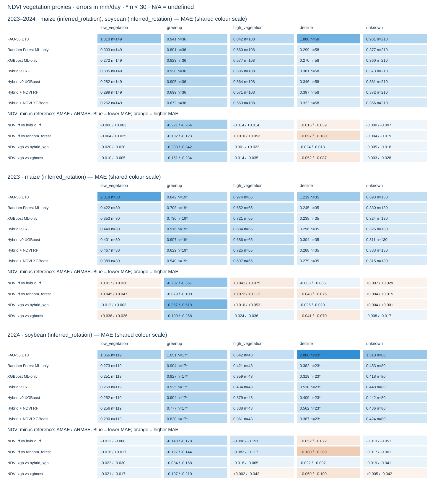

# Качество прогнозов по приближённым NDVI-фазам — US-Ne2

Семь сохранённых моделей; тест 2023–2024. Модели и границы фаз не изменяются. Это описательный анализ по proxy_stage, а не подтверждение агрономических стадий. Низкая растительность не равнозначна подтверждённому вне вегетационному периоду. Фактические стадии учитываются отдельно в покрытии; результаты по ним здесь не подменяются NDVI.

Все модели используют одинаковые даты и y_obs внутри каждой группы. unknown сохраняется как отдельная группа. Доли рассчитаны от тестовых дат соответствующего периода; 731 календарный день содержит 561 тестовое наблюдение, 170 дней без ET не заполняются.

MAE — основная метрика; MAE, RMSE, bias и их разности выражены в мм/день. Положительный bias означает завышение. Pearson r² — квадрат корреляции; R² совпадает с NSE. n < 30 отмечено small_group=True (описательное предупреждение, не тест значимости). N/A означает неопределённую метрику: причины сохранены в таблицах. Пустые группы сохранены с n=0. FAO-56 оценивает эталонную ET₀, сравниваемую здесь с фактической ET.

## Покрытие разметки

| period | stage | n | share | crop_context | crop_labels | small_group | actual_unknown_n |
| --- | --- | --- | --- | --- | --- | --- | --- |
| 2023–2024 | proxy_low_vegetation | 149 | 0.2656 | 2023/maize/inferred_rotation: 30; 2024/soybean/inferred_rotation: 119 | maize (inferred_rotation); soybean (inferred_rotation) | False | 149 |
| 2023–2024 | proxy_greenup | 36 | 0.0642 | 2023/maize/inferred_rotation: 19; 2024/soybean/inferred_rotation: 17 | maize (inferred_rotation); soybean (inferred_rotation) | False | 36 |
| 2023–2024 | proxy_high_vegetation | 108 | 0.1925 | 2023/maize/inferred_rotation: 65; 2024/soybean/inferred_rotation: 43 | maize (inferred_rotation); soybean (inferred_rotation) | False | 108 |
| 2023–2024 | proxy_decline | 58 | 0.1034 | 2023/maize/inferred_rotation: 35; 2024/soybean/inferred_rotation: 23 | maize (inferred_rotation); soybean (inferred_rotation) | False | 58 |
| 2023–2024 | unknown | 210 | 0.3743 | 2023/maize/inferred_rotation: 130; 2024/soybean/inferred_rotation: 80 | maize (inferred_rotation); soybean (inferred_rotation) | False | 210 |
| 2023 | proxy_low_vegetation | 30 | 0.1075 | 2023/maize/inferred_rotation: 30 | maize (inferred_rotation) | False | 30 |
| 2023 | proxy_greenup | 19 | 0.0681 | 2023/maize/inferred_rotation: 19 | maize (inferred_rotation) | True | 19 |
| 2023 | proxy_high_vegetation | 65 | 0.2330 | 2023/maize/inferred_rotation: 65 | maize (inferred_rotation) | False | 65 |
| 2023 | proxy_decline | 35 | 0.1254 | 2023/maize/inferred_rotation: 35 | maize (inferred_rotation) | False | 35 |
| 2023 | unknown | 130 | 0.4659 | 2023/maize/inferred_rotation: 130 | maize (inferred_rotation) | False | 130 |
| 2024 | proxy_low_vegetation | 119 | 0.4220 | 2024/soybean/inferred_rotation: 119 | soybean (inferred_rotation) | False | 119 |
| 2024 | proxy_greenup | 17 | 0.0603 | 2024/soybean/inferred_rotation: 17 | soybean (inferred_rotation) | True | 17 |
| 2024 | proxy_high_vegetation | 43 | 0.1525 | 2024/soybean/inferred_rotation: 43 | soybean (inferred_rotation) | False | 43 |
| 2024 | proxy_decline | 23 | 0.0816 | 2024/soybean/inferred_rotation: 23 | soybean (inferred_rotation) | True | 23 |
| 2024 | unknown | 80 | 0.2837 | 2024/soybean/inferred_rotation: 80 | soybean (inferred_rotation) | False | 80 |

## Ошибки и разности



## 2023–2024

| stage | n | crop_labels | small_group | model | rmse | mae | bias | nse | kge | pearson_r2 | r2_score | undefined_metrics | undefined_reasons |
| --- | --- | --- | --- | --- | --- | --- | --- | --- | --- | --- | --- | --- | --- |
| proxy_low_vegetation | 149 | maize (inferred_rotation); soybean (inferred_rotation) | False | fao56_et0 | 1.8347 | 1.3098 | 1.2731 | -14.5029 | -2.2919 | 0.1373 | -14.5029 |  |  |
| proxy_low_vegetation | 149 | maize (inferred_rotation); soybean (inferred_rotation) | False | random_forest | 0.3975 | 0.3026 | 0.2112 | 0.2722 | 0.4697 | 0.4980 | 0.2722 |  |  |
| proxy_low_vegetation | 149 | maize (inferred_rotation); soybean (inferred_rotation) | False | xgboost | 0.3690 | 0.2716 | 0.1774 | 0.3727 | 0.5487 | 0.5410 | 0.3727 |  |  |
| proxy_low_vegetation | 149 | maize (inferred_rotation); soybean (inferred_rotation) | False | hybrid_rf | 0.4204 | 0.3050 | 0.1964 | 0.1859 | 0.4901 | 0.4473 | 0.1859 |  |  |
| proxy_low_vegetation | 149 | maize (inferred_rotation); soybean (inferred_rotation) | False | hybrid_xgb | 0.3845 | 0.2817 | 0.1730 | 0.3191 | 0.5464 | 0.5028 | 0.3191 |  |  |
| proxy_low_vegetation | 149 | maize (inferred_rotation); soybean (inferred_rotation) | False | hybrid_ndvi_rf | 0.4223 | 0.2986 | 0.1668 | 0.1787 | 0.5189 | 0.4196 | 0.1787 |  |  |
| proxy_low_vegetation | 149 | maize (inferred_rotation); soybean (inferred_rotation) | False | hybrid_ndvi_xgb | 0.3640 | 0.2619 | 0.1282 | 0.3897 | 0.5986 | 0.4995 | 0.3897 |  |  |
| proxy_greenup | 36 | maize (inferred_rotation); soybean (inferred_rotation) | False | fao56_et0 | 1.3383 | 0.9411 | 0.5990 | 0.1046 | 0.6138 | 0.4108 | 0.1046 |  |  |
| proxy_greenup | 36 | maize (inferred_rotation); soybean (inferred_rotation) | False | random_forest | 1.0142 | 0.8009 | 0.0238 | 0.4857 | 0.7500 | 0.5941 | 0.4857 |  |  |
| proxy_greenup | 36 | maize (inferred_rotation); soybean (inferred_rotation) | False | xgboost | 1.0683 | 0.8232 | 0.0311 | 0.4295 | 0.7227 | 0.5706 | 0.4295 |  |  |
| proxy_greenup | 36 | maize (inferred_rotation); soybean (inferred_rotation) | False | hybrid_rf | 1.1559 | 0.9202 | -0.0772 | 0.3321 | 0.6699 | 0.5493 | 0.3321 |  |  |
| proxy_greenup | 36 | maize (inferred_rotation); soybean (inferred_rotation) | False | hybrid_xgb | 1.1757 | 0.9053 | -0.1094 | 0.3090 | 0.6593 | 0.5436 | 0.3090 |  |  |
| proxy_greenup | 36 | maize (inferred_rotation); soybean (inferred_rotation) | False | hybrid_ndvi_rf | 0.8914 | 0.6989 | 0.0135 | 0.6028 | 0.8056 | 0.6576 | 0.6028 |  |  |
| proxy_greenup | 36 | maize (inferred_rotation); soybean (inferred_rotation) | False | hybrid_ndvi_xgb | 0.8341 | 0.6723 | 0.1460 | 0.6522 | 0.8302 | 0.7037 | 0.6522 |  |  |
| proxy_high_vegetation | 108 | maize (inferred_rotation); soybean (inferred_rotation) | False | fao56_et0 | 1.2795 | 0.8419 | 0.4270 | 0.3835 | 0.5717 | 0.4574 | 0.3835 |  |  |
| proxy_high_vegetation | 108 | maize (inferred_rotation); soybean (inferred_rotation) | False | random_forest | 0.7397 | 0.5604 | 0.2612 | 0.7939 | 0.8532 | 0.8198 | 0.7939 |  |  |
| proxy_high_vegetation | 108 | maize (inferred_rotation); soybean (inferred_rotation) | False | xgboost | 0.7950 | 0.5767 | 0.3314 | 0.7620 | 0.8516 | 0.8063 | 0.7620 |  |  |
| proxy_high_vegetation | 108 | maize (inferred_rotation); soybean (inferred_rotation) | False | hybrid_rf | 0.7789 | 0.5847 | 0.2504 | 0.7715 | 0.8597 | 0.7979 | 0.7715 |  |  |
| proxy_high_vegetation | 108 | maize (inferred_rotation); soybean (inferred_rotation) | False | hybrid_xgb | 0.7376 | 0.5640 | 0.2582 | 0.7951 | 0.8625 | 0.8210 | 0.7951 |  |  |
| proxy_high_vegetation | 108 | maize (inferred_rotation); soybean (inferred_rotation) | False | hybrid_ndvi_rf | 0.7929 | 0.5709 | 0.3115 | 0.7633 | 0.8350 | 0.8001 | 0.7633 |  |  |
| proxy_high_vegetation | 108 | maize (inferred_rotation); soybean (inferred_rotation) | False | hybrid_ndvi_xgb | 0.7595 | 0.5629 | 0.3318 | 0.7828 | 0.8572 | 0.8258 | 0.7828 |  |  |
| proxy_decline | 58 | maize (inferred_rotation); soybean (inferred_rotation) | False | fao56_et0 | 2.1993 | 1.8805 | 1.7163 | -30.6354 | -2.9838 | 0.0903 | -30.6354 |  |  |
| proxy_decline | 58 | maize (inferred_rotation); soybean (inferred_rotation) | False | random_forest | 0.3586 | 0.2993 | 0.1764 | 0.1590 | 0.3480 | 0.3624 | 0.1590 |  |  |
| proxy_decline | 58 | maize (inferred_rotation); soybean (inferred_rotation) | False | xgboost | 0.3411 | 0.2700 | 0.1546 | 0.2389 | 0.4273 | 0.3965 | 0.2389 |  |  |
| proxy_decline | 58 | maize (inferred_rotation); soybean (inferred_rotation) | False | hybrid_rf | 0.4993 | 0.3811 | 0.1865 | -0.6308 | 0.2330 | 0.0981 | -0.6308 |  |  |
| proxy_decline | 58 | maize (inferred_rotation); soybean (inferred_rotation) | False | hybrid_xgb | 0.4412 | 0.3459 | 0.1034 | -0.2730 | 0.2861 | 0.1041 | -0.2730 |  |  |
| proxy_decline | 58 | maize (inferred_rotation); soybean (inferred_rotation) | False | hybrid_ndvi_rf | 0.5388 | 0.3966 | 0.2093 | -0.8989 | 0.1551 | 0.0625 | -0.8989 |  |  |
| proxy_decline | 58 | maize (inferred_rotation); soybean (inferred_rotation) | False | hybrid_ndvi_xgb | 0.4284 | 0.3219 | 0.1347 | -0.2004 | 0.3268 | 0.1500 | -0.2004 |  |  |
| unknown | 210 | maize (inferred_rotation); soybean (inferred_rotation) | False | fao56_et0 | 1.5318 | 0.9310 | 0.7513 | -2.3773 | -0.3707 | 0.3914 | -2.3773 |  |  |
| unknown | 210 | maize (inferred_rotation); soybean (inferred_rotation) | False | random_forest | 0.5655 | 0.3768 | -0.0024 | 0.5397 | 0.7741 | 0.6010 | 0.5397 |  |  |
| unknown | 210 | maize (inferred_rotation); soybean (inferred_rotation) | False | xgboost | 0.5458 | 0.3596 | -0.0268 | 0.5712 | 0.7870 | 0.6235 | 0.5712 |  |  |
| unknown | 210 | maize (inferred_rotation); soybean (inferred_rotation) | False | hybrid_rf | 0.5535 | 0.3728 | -0.0289 | 0.5591 | 0.7768 | 0.6071 | 0.5591 |  |  |
| unknown | 210 | maize (inferred_rotation); soybean (inferred_rotation) | False | hybrid_xgb | 0.5352 | 0.3611 | -0.0308 | 0.5876 | 0.7899 | 0.6286 | 0.5876 |  |  |
| unknown | 210 | maize (inferred_rotation); soybean (inferred_rotation) | False | hybrid_ndvi_rf | 0.5466 | 0.3724 | -0.0369 | 0.5699 | 0.7770 | 0.6110 | 0.5699 |  |  |
| unknown | 210 | maize (inferred_rotation); soybean (inferred_rotation) | False | hybrid_ndvi_xgb | 0.5176 | 0.3564 | -0.0383 | 0.6144 | 0.8041 | 0.6541 | 0.6144 |  |  |

NDVI minus baseline: отрицательная разность означает меньшую ошибку.

| stage | model | baseline | n | small_group | delta_mae | delta_rmse |
| --- | --- | --- | --- | --- | --- | --- |
| proxy_low_vegetation | hybrid_ndvi_rf | hybrid_rf | 149 | False | -0.0065 | 0.0019 |
| proxy_low_vegetation | hybrid_ndvi_rf | random_forest | 149 | False | -0.0040 | 0.0248 |
| proxy_low_vegetation | hybrid_ndvi_xgb | hybrid_xgb | 149 | False | -0.0198 | -0.0205 |
| proxy_low_vegetation | hybrid_ndvi_xgb | xgboost | 149 | False | -0.0097 | -0.0050 |
| proxy_greenup | hybrid_ndvi_rf | hybrid_rf | 36 | False | -0.2213 | -0.2645 |
| proxy_greenup | hybrid_ndvi_rf | random_forest | 36 | False | -0.1020 | -0.1228 |
| proxy_greenup | hybrid_ndvi_xgb | hybrid_xgb | 36 | False | -0.2330 | -0.3416 |
| proxy_greenup | hybrid_ndvi_xgb | xgboost | 36 | False | -0.1509 | -0.2342 |
| proxy_high_vegetation | hybrid_ndvi_rf | hybrid_rf | 108 | False | -0.0139 | 0.0139 |
| proxy_high_vegetation | hybrid_ndvi_rf | random_forest | 108 | False | 0.0105 | 0.0532 |
| proxy_high_vegetation | hybrid_ndvi_xgb | hybrid_xgb | 108 | False | -0.0011 | 0.0219 |
| proxy_high_vegetation | hybrid_ndvi_xgb | xgboost | 108 | False | -0.0138 | -0.0354 |
| proxy_decline | hybrid_ndvi_rf | hybrid_rf | 58 | False | 0.0155 | 0.0395 |
| proxy_decline | hybrid_ndvi_rf | random_forest | 58 | False | 0.0973 | 0.1802 |
| proxy_decline | hybrid_ndvi_xgb | hybrid_xgb | 58 | False | -0.0241 | -0.0128 |
| proxy_decline | hybrid_ndvi_xgb | xgboost | 58 | False | 0.0519 | 0.0873 |
| unknown | hybrid_ndvi_rf | hybrid_rf | 210 | False | -0.0004 | -0.0068 |
| unknown | hybrid_ndvi_rf | random_forest | 210 | False | -0.0044 | -0.0189 |
| unknown | hybrid_ndvi_xgb | hybrid_xgb | 210 | False | -0.0047 | -0.0177 |
| unknown | hybrid_ndvi_xgb | xgboost | 210 | False | -0.0032 | -0.0282 |

- Hybrid + NDVI RF против Hybrid v0 RF: MAE ниже в proxy_low_vegetation, proxy_greenup, proxy_high_vegetation, unknown; выше в proxy_decline.
- Hybrid + NDVI RF против Random Forest ML-only: MAE ниже в proxy_low_vegetation, proxy_greenup, unknown; выше в proxy_high_vegetation, proxy_decline.
- Hybrid + NDVI XGBoost против Hybrid v0 XGBoost: MAE ниже в proxy_low_vegetation, proxy_greenup, proxy_high_vegetation, proxy_decline, unknown; выше в нет.
- Hybrid + NDVI XGBoost против XGBoost ML-only: MAE ниже в proxy_low_vegetation, proxy_greenup, proxy_high_vegetation, unknown; выше в proxy_decline.

## 2023

| stage | n | crop_labels | small_group | model | rmse | mae | bias | nse | kge | pearson_r2 | r2_score | undefined_metrics | undefined_reasons |
| --- | --- | --- | --- | --- | --- | --- | --- | --- | --- | --- | --- | --- | --- |
| proxy_low_vegetation | 30 | maize (inferred_rotation) | False | fao56_et0 | 2.6859 | 2.3178 | 2.3178 | -87.2615 | -3.9896 | 0.0068 | -87.2615 |  |  |
| proxy_low_vegetation | 30 | maize (inferred_rotation) | False | random_forest | 0.5430 | 0.4216 | 0.3525 | -2.6077 | -0.3249 | 0.0463 | -2.6077 |  |  |
| proxy_low_vegetation | 30 | maize (inferred_rotation) | False | xgboost | 0.4778 | 0.3528 | 0.2678 | -1.7937 | -0.1159 | 0.0019 | -1.7937 |  |  |
| proxy_low_vegetation | 30 | maize (inferred_rotation) | False | hybrid_rf | 0.5637 | 0.4492 | 0.3531 | -2.8882 | -0.1152 | 0.0006 | -2.8882 |  |  |
| proxy_low_vegetation | 30 | maize (inferred_rotation) | False | hybrid_xgb | 0.5011 | 0.4013 | 0.2915 | -2.0719 | 0.0271 | 0.0187 | -2.0719 |  |  |
| proxy_low_vegetation | 30 | maize (inferred_rotation) | False | hybrid_ndvi_rf | 0.5901 | 0.4666 | 0.3342 | -3.2609 | -0.1827 | 0.0004 | -3.2609 |  |  |
| proxy_low_vegetation | 30 | maize (inferred_rotation) | False | hybrid_ndvi_xgb | 0.5037 | 0.3889 | 0.2219 | -2.1045 | -0.0977 | 0.0011 | -2.1045 |  |  |
| proxy_greenup | 19 | maize (inferred_rotation) | True | fao56_et0 | 0.9670 | 0.8424 | 0.5555 | 0.5234 | 0.7842 | 0.7307 | 0.5234 |  |  |
| proxy_greenup | 19 | maize (inferred_rotation) | True | random_forest | 0.8981 | 0.7084 | -0.6185 | 0.5889 | 0.8085 | 0.7915 | 0.5889 |  |  |
| proxy_greenup | 19 | maize (inferred_rotation) | True | xgboost | 0.9558 | 0.7303 | -0.6436 | 0.5344 | 0.7954 | 0.7669 | 0.5344 |  |  |
| proxy_greenup | 19 | maize (inferred_rotation) | True | hybrid_rf | 1.1487 | 0.9161 | -0.8681 | 0.3275 | 0.7390 | 0.7456 | 0.3275 |  |  |
| proxy_greenup | 19 | maize (inferred_rotation) | True | hybrid_xgb | 1.2074 | 0.9066 | -0.8870 | 0.2569 | 0.7191 | 0.7093 | 0.2569 |  |  |
| proxy_greenup | 19 | maize (inferred_rotation) | True | hybrid_ndvi_rf | 0.7977 | 0.6292 | -0.5330 | 0.6757 | 0.8360 | 0.8248 | 0.6757 |  |  |
| proxy_greenup | 19 | maize (inferred_rotation) | True | hybrid_ndvi_xgb | 0.6882 | 0.5400 | -0.3719 | 0.7586 | 0.8612 | 0.8304 | 0.7586 |  |  |
| proxy_high_vegetation | 65 | maize (inferred_rotation) | False | fao56_et0 | 1.4876 | 0.9744 | 0.7068 | 0.2620 | 0.5235 | 0.4360 | 0.2620 |  |  |
| proxy_high_vegetation | 65 | maize (inferred_rotation) | False | random_forest | 0.8429 | 0.6524 | 0.5651 | 0.7631 | 0.7934 | 0.8700 | 0.7631 |  |  |
| proxy_high_vegetation | 65 | maize (inferred_rotation) | False | xgboost | 0.9495 | 0.7208 | 0.6421 | 0.6994 | 0.7781 | 0.8378 | 0.6994 |  |  |
| proxy_high_vegetation | 65 | maize (inferred_rotation) | False | hybrid_rf | 0.8855 | 0.6844 | 0.5722 | 0.7385 | 0.7922 | 0.8477 | 0.7385 |  |  |
| proxy_high_vegetation | 65 | maize (inferred_rotation) | False | hybrid_xgb | 0.8605 | 0.6863 | 0.5738 | 0.7531 | 0.7886 | 0.8633 | 0.7531 |  |  |
| proxy_high_vegetation | 65 | maize (inferred_rotation) | False | hybrid_ndvi_rf | 0.9601 | 0.7249 | 0.6355 | 0.6926 | 0.7474 | 0.8291 | 0.6926 |  |  |
| proxy_high_vegetation | 65 | maize (inferred_rotation) | False | hybrid_ndvi_xgb | 0.9138 | 0.6966 | 0.6072 | 0.7215 | 0.7732 | 0.8448 | 0.7215 |  |  |
| proxy_decline | 35 | maize (inferred_rotation) | False | fao56_et0 | 1.3870 | 1.2194 | 0.9474 | -8.4553 | -1.1965 | 0.1720 | -8.4553 |  |  |
| proxy_decline | 35 | maize (inferred_rotation) | False | random_forest | 0.3116 | 0.2452 | 0.0741 | 0.5229 | 0.4633 | 0.6201 | 0.5229 |  |  |
| proxy_decline | 35 | maize (inferred_rotation) | False | xgboost | 0.3153 | 0.2379 | 0.0672 | 0.5115 | 0.5256 | 0.5487 | 0.5115 |  |  |
| proxy_decline | 35 | maize (inferred_rotation) | False | hybrid_rf | 0.3818 | 0.2963 | 0.0327 | 0.2834 | 0.4137 | 0.2967 | 0.2834 |  |  |
| proxy_decline | 35 | maize (inferred_rotation) | False | hybrid_xgb | 0.4142 | 0.3043 | -0.0160 | 0.1570 | 0.3233 | 0.1923 | 0.1570 |  |  |
| proxy_decline | 35 | maize (inferred_rotation) | False | hybrid_ndvi_rf | 0.3877 | 0.2880 | 0.0233 | 0.2614 | 0.3440 | 0.2659 | 0.2614 |  |  |
| proxy_decline | 35 | maize (inferred_rotation) | False | hybrid_ndvi_xgb | 0.3854 | 0.2788 | 0.0179 | 0.2698 | 0.4047 | 0.2821 | 0.2698 |  |  |
| unknown | 130 | maize (inferred_rotation) | False | fao56_et0 | 1.2467 | 0.6929 | 0.4721 | -2.3681 | -0.2968 | 0.3001 | -2.3681 |  |  |
| unknown | 130 | maize (inferred_rotation) | False | random_forest | 0.4844 | 0.3299 | -0.0677 | 0.4914 | 0.5683 | 0.5015 | 0.4914 |  |  |
| unknown | 130 | maize (inferred_rotation) | False | xgboost | 0.4740 | 0.3235 | -0.0878 | 0.5131 | 0.5739 | 0.5309 | 0.5131 |  |  |
| unknown | 130 | maize (inferred_rotation) | False | hybrid_rf | 0.4706 | 0.3262 | -0.0925 | 0.5200 | 0.5858 | 0.5392 | 0.5200 |  |  |
| unknown | 130 | maize (inferred_rotation) | False | hybrid_xgb | 0.4554 | 0.3113 | -0.0825 | 0.5506 | 0.6244 | 0.5655 | 0.5506 |  |  |
| unknown | 130 | maize (inferred_rotation) | False | hybrid_ndvi_rf | 0.4995 | 0.3334 | -0.0795 | 0.4593 | 0.6374 | 0.4896 | 0.4593 |  |  |
| unknown | 130 | maize (inferred_rotation) | False | hybrid_ndvi_xgb | 0.4567 | 0.3151 | -0.0778 | 0.5480 | 0.7025 | 0.5730 | 0.5480 |  |  |

NDVI minus baseline: отрицательная разность означает меньшую ошибку.

| stage | model | baseline | n | small_group | delta_mae | delta_rmse |
| --- | --- | --- | --- | --- | --- | --- |
| proxy_low_vegetation | hybrid_ndvi_rf | hybrid_rf | 30 | False | 0.0174 | 0.0264 |
| proxy_low_vegetation | hybrid_ndvi_rf | random_forest | 30 | False | 0.0450 | 0.0471 |
| proxy_low_vegetation | hybrid_ndvi_xgb | hybrid_xgb | 30 | False | -0.0124 | 0.0027 |
| proxy_low_vegetation | hybrid_ndvi_xgb | xgboost | 30 | False | 0.0361 | 0.0259 |
| proxy_greenup | hybrid_ndvi_rf | hybrid_rf | 19 | True | -0.2869 | -0.3510 |
| proxy_greenup | hybrid_ndvi_rf | random_forest | 19 | True | -0.0792 | -0.1004 |
| proxy_greenup | hybrid_ndvi_xgb | hybrid_xgb | 19 | True | -0.3666 | -0.5192 |
| proxy_greenup | hybrid_ndvi_xgb | xgboost | 19 | True | -0.1903 | -0.2676 |
| proxy_high_vegetation | hybrid_ndvi_rf | hybrid_rf | 65 | False | 0.0406 | 0.0746 |
| proxy_high_vegetation | hybrid_ndvi_rf | random_forest | 65 | False | 0.0725 | 0.1172 |
| proxy_high_vegetation | hybrid_ndvi_xgb | hybrid_xgb | 65 | False | 0.0102 | 0.0533 |
| proxy_high_vegetation | hybrid_ndvi_xgb | xgboost | 65 | False | -0.0242 | -0.0356 |
| proxy_decline | hybrid_ndvi_rf | hybrid_rf | 35 | False | -0.0083 | 0.0058 |
| proxy_decline | hybrid_ndvi_rf | random_forest | 35 | False | 0.0428 | 0.0761 |
| proxy_decline | hybrid_ndvi_xgb | hybrid_xgb | 35 | False | -0.0255 | -0.0287 |
| proxy_decline | hybrid_ndvi_xgb | xgboost | 35 | False | 0.0408 | 0.0702 |
| unknown | hybrid_ndvi_rf | hybrid_rf | 130 | False | 0.0072 | 0.0289 |
| unknown | hybrid_ndvi_rf | random_forest | 130 | False | 0.0035 | 0.0151 |
| unknown | hybrid_ndvi_xgb | hybrid_xgb | 130 | False | 0.0038 | 0.0013 |
| unknown | hybrid_ndvi_xgb | xgboost | 130 | False | -0.0084 | -0.0173 |

- Hybrid + NDVI RF против Hybrid v0 RF: MAE ниже в proxy_greenup, proxy_decline; выше в proxy_low_vegetation, proxy_high_vegetation, unknown.
- Hybrid + NDVI RF против Random Forest ML-only: MAE ниже в proxy_greenup; выше в proxy_low_vegetation, proxy_high_vegetation, proxy_decline, unknown.
- Hybrid + NDVI XGBoost против Hybrid v0 XGBoost: MAE ниже в proxy_low_vegetation, proxy_greenup, proxy_decline; выше в proxy_high_vegetation, unknown.
- Hybrid + NDVI XGBoost против XGBoost ML-only: MAE ниже в proxy_greenup, proxy_high_vegetation, unknown; выше в proxy_low_vegetation, proxy_decline.

## 2024

| stage | n | crop_labels | small_group | model | rmse | mae | bias | nse | kge | pearson_r2 | r2_score | undefined_metrics | undefined_reasons |
| --- | --- | --- | --- | --- | --- | --- | --- | --- | --- | --- | --- | --- | --- |
| proxy_low_vegetation | 119 | soybean (inferred_rotation) | False | fao56_et0 | 1.5479 | 1.0557 | 1.0097 | -8.9760 | -1.7740 | 0.1505 | -8.9760 |  |  |
| proxy_low_vegetation | 119 | soybean (inferred_rotation) | False | random_forest | 0.3515 | 0.2726 | 0.1755 | 0.4857 | 0.5116 | 0.6140 | 0.4857 |  |  |
| proxy_low_vegetation | 119 | soybean (inferred_rotation) | False | xgboost | 0.3361 | 0.2511 | 0.1546 | 0.5297 | 0.5795 | 0.6321 | 0.5297 |  |  |
| proxy_low_vegetation | 119 | soybean (inferred_rotation) | False | hybrid_rf | 0.3758 | 0.2687 | 0.1569 | 0.4121 | 0.5488 | 0.5346 | 0.4121 |  |  |
| proxy_low_vegetation | 119 | soybean (inferred_rotation) | False | hybrid_xgb | 0.3490 | 0.2515 | 0.1431 | 0.4929 | 0.5843 | 0.5857 | 0.4929 |  |  |
| proxy_low_vegetation | 119 | soybean (inferred_rotation) | False | hybrid_ndvi_rf | 0.3681 | 0.2562 | 0.1246 | 0.4359 | 0.5957 | 0.5244 | 0.4359 |  |  |
| proxy_low_vegetation | 119 | soybean (inferred_rotation) | False | hybrid_ndvi_xgb | 0.3193 | 0.2299 | 0.1046 | 0.5755 | 0.6422 | 0.6221 | 0.5755 |  |  |
| proxy_greenup | 17 | soybean (inferred_rotation) | True | fao56_et0 | 1.6577 | 1.0515 | 0.6477 | -0.4215 | 0.2990 | 0.1054 | -0.4215 |  |  |
| proxy_greenup | 17 | soybean (inferred_rotation) | True | random_forest | 1.1300 | 0.9042 | 0.7415 | 0.3394 | 0.6748 | 0.6246 | 0.3394 |  |  |
| proxy_greenup | 17 | soybean (inferred_rotation) | True | xgboost | 1.1814 | 0.9271 | 0.7852 | 0.2780 | 0.6512 | 0.5978 | 0.2780 |  |  |
| proxy_greenup | 17 | soybean (inferred_rotation) | True | hybrid_rf | 1.1639 | 0.9247 | 0.8068 | 0.2992 | 0.6802 | 0.6369 | 0.2992 |  |  |
| proxy_greenup | 17 | soybean (inferred_rotation) | True | hybrid_xgb | 1.1393 | 0.9037 | 0.7597 | 0.3286 | 0.6965 | 0.6309 | 0.3286 |  |  |
| proxy_greenup | 17 | soybean (inferred_rotation) | True | hybrid_ndvi_rf | 0.9856 | 0.7768 | 0.6244 | 0.4974 | 0.6908 | 0.7029 | 0.4974 |  |  |
| proxy_greenup | 17 | soybean (inferred_rotation) | True | hybrid_ndvi_xgb | 0.9716 | 0.8201 | 0.7249 | 0.5117 | 0.7415 | 0.7863 | 0.5117 |  |  |
| proxy_high_vegetation | 43 | soybean (inferred_rotation) | False | fao56_et0 | 0.8755 | 0.6415 | 0.0039 | 0.6192 | 0.6823 | 0.6197 | 0.6192 |  |  |
| proxy_high_vegetation | 43 | soybean (inferred_rotation) | False | random_forest | 0.5480 | 0.4212 | -0.1981 | 0.8508 | 0.8971 | 0.8704 | 0.8508 |  |  |
| proxy_high_vegetation | 43 | soybean (inferred_rotation) | False | xgboost | 0.4739 | 0.3588 | -0.1384 | 0.8884 | 0.9327 | 0.8989 | 0.8884 |  |  |
| proxy_high_vegetation | 43 | soybean (inferred_rotation) | False | hybrid_rf | 0.5819 | 0.4341 | -0.2361 | 0.8318 | 0.9051 | 0.8647 | 0.8318 |  |  |
| proxy_high_vegetation | 43 | soybean (inferred_rotation) | False | hybrid_xgb | 0.4973 | 0.3791 | -0.2188 | 0.8771 | 0.9227 | 0.9032 | 0.8771 |  |  |
| proxy_high_vegetation | 43 | soybean (inferred_rotation) | False | hybrid_ndvi_rf | 0.4306 | 0.3379 | -0.1783 | 0.9079 | 0.9381 | 0.9258 | 0.9079 |  |  |
| proxy_high_vegetation | 43 | soybean (inferred_rotation) | False | hybrid_ndvi_xgb | 0.4320 | 0.3608 | -0.0845 | 0.9073 | 0.9196 | 0.9220 | 0.9073 |  |  |
| proxy_decline | 23 | soybean (inferred_rotation) | True | fao56_et0 | 3.0446 | 2.8865 | 2.8865 | -150.8467 | -6.0580 | 0.0085 | -150.8467 |  |  |
| proxy_decline | 23 | soybean (inferred_rotation) | True | random_forest | 0.4201 | 0.3816 | 0.3319 | -1.8917 | 0.0355 | 0.1495 | -1.8917 |  |  |
| proxy_decline | 23 | soybean (inferred_rotation) | True | xgboost | 0.3771 | 0.3187 | 0.2876 | -1.3295 | 0.1672 | 0.2201 | -1.3295 |  |  |
| proxy_decline | 23 | soybean (inferred_rotation) | True | hybrid_rf | 0.6379 | 0.5102 | 0.4206 | -5.6653 | -0.5317 | 0.0974 | -5.6653 |  |  |
| proxy_decline | 23 | soybean (inferred_rotation) | True | hybrid_xgb | 0.4793 | 0.4093 | 0.2850 | -2.7638 | -0.0891 | 0.1454 | -2.7638 |  |  |
| proxy_decline | 23 | soybean (inferred_rotation) | True | hybrid_ndvi_rf | 0.7095 | 0.5619 | 0.4924 | -7.2465 | -0.7318 | 0.1083 | -7.2465 |  |  |
| proxy_decline | 23 | soybean (inferred_rotation) | True | hybrid_ndvi_xgb | 0.4866 | 0.3874 | 0.3125 | -2.8784 | -0.0928 | 0.1562 | -2.8784 |  |  |
| unknown | 80 | soybean (inferred_rotation) | False | fao56_et0 | 1.9062 | 1.3179 | 1.2051 | -2.8847 | -0.4233 | 0.3867 | -2.8847 |  |  |
| unknown | 80 | soybean (inferred_rotation) | False | random_forest | 0.6769 | 0.4529 | 0.1038 | 0.5102 | 0.7279 | 0.6545 | 0.5102 |  |  |
| unknown | 80 | soybean (inferred_rotation) | False | xgboost | 0.6457 | 0.4182 | 0.0723 | 0.5543 | 0.7497 | 0.6778 | 0.5543 |  |  |
| unknown | 80 | soybean (inferred_rotation) | False | hybrid_rf | 0.6665 | 0.4485 | 0.0746 | 0.5251 | 0.7557 | 0.6361 | 0.5251 |  |  |
| unknown | 80 | soybean (inferred_rotation) | False | hybrid_xgb | 0.6442 | 0.4421 | 0.0534 | 0.5563 | 0.7734 | 0.6511 | 0.5563 |  |  |
| unknown | 80 | soybean (inferred_rotation) | False | hybrid_ndvi_rf | 0.6156 | 0.4358 | 0.0323 | 0.5949 | 0.8006 | 0.6527 | 0.5949 |  |  |
| unknown | 80 | soybean (inferred_rotation) | False | hybrid_ndvi_xgb | 0.6036 | 0.4236 | 0.0258 | 0.6105 | 0.8066 | 0.6724 | 0.6105 |  |  |

NDVI minus baseline: отрицательная разность означает меньшую ошибку.

| stage | model | baseline | n | small_group | delta_mae | delta_rmse |
| --- | --- | --- | --- | --- | --- | --- |
| proxy_low_vegetation | hybrid_ndvi_rf | hybrid_rf | 119 | False | -0.0125 | -0.0077 |
| proxy_low_vegetation | hybrid_ndvi_rf | random_forest | 119 | False | -0.0164 | 0.0166 |
| proxy_low_vegetation | hybrid_ndvi_xgb | hybrid_xgb | 119 | False | -0.0217 | -0.0297 |
| proxy_low_vegetation | hybrid_ndvi_xgb | xgboost | 119 | False | -0.0212 | -0.0168 |
| proxy_greenup | hybrid_ndvi_rf | hybrid_rf | 17 | True | -0.1479 | -0.1783 |
| proxy_greenup | hybrid_ndvi_rf | random_forest | 17 | True | -0.1274 | -0.1444 |
| proxy_greenup | hybrid_ndvi_xgb | hybrid_xgb | 17 | True | -0.0836 | -0.1677 |
| proxy_greenup | hybrid_ndvi_xgb | xgboost | 17 | True | -0.1069 | -0.2098 |
| proxy_high_vegetation | hybrid_ndvi_rf | hybrid_rf | 43 | False | -0.0961 | -0.1512 |
| proxy_high_vegetation | hybrid_ndvi_rf | random_forest | 43 | False | -0.0832 | -0.1173 |
| proxy_high_vegetation | hybrid_ndvi_xgb | hybrid_xgb | 43 | False | -0.0183 | -0.0653 |
| proxy_high_vegetation | hybrid_ndvi_xgb | xgboost | 43 | False | 0.0019 | -0.0419 |
| proxy_decline | hybrid_ndvi_rf | hybrid_rf | 23 | True | 0.0517 | 0.0716 |
| proxy_decline | hybrid_ndvi_rf | random_forest | 23 | True | 0.1803 | 0.2894 |
| proxy_decline | hybrid_ndvi_xgb | hybrid_xgb | 23 | True | -0.0219 | 0.0072 |
| proxy_decline | hybrid_ndvi_xgb | xgboost | 23 | True | 0.0687 | 0.1095 |
| unknown | hybrid_ndvi_rf | hybrid_rf | 80 | False | -0.0127 | -0.0509 |
| unknown | hybrid_ndvi_rf | random_forest | 80 | False | -0.0172 | -0.0613 |
| unknown | hybrid_ndvi_xgb | hybrid_xgb | 80 | False | -0.0186 | -0.0407 |
| unknown | hybrid_ndvi_xgb | xgboost | 80 | False | 0.0054 | -0.0421 |

- Hybrid + NDVI RF против Hybrid v0 RF: MAE ниже в proxy_low_vegetation, proxy_greenup, proxy_high_vegetation, unknown; выше в proxy_decline.
- Hybrid + NDVI RF против Random Forest ML-only: MAE ниже в proxy_low_vegetation, proxy_greenup, proxy_high_vegetation, unknown; выше в proxy_decline.
- Hybrid + NDVI XGBoost против Hybrid v0 XGBoost: MAE ниже в proxy_low_vegetation, proxy_greenup, proxy_high_vegetation, proxy_decline, unknown; выше в нет.
- Hybrid + NDVI XGBoost против XGBoost ML-only: MAE ниже в proxy_low_vegetation, proxy_greenup; выше в proxy_high_vegetation, proxy_decline, unknown.

## Основные наблюдения

- Hybrid + NDVI RF: минимальная ΔMAE против v0 в proxy_greenup: -0.2213 мм/день, n=36. Отрицательный знак означает улучшение.
- Hybrid + NDVI XGBoost: минимальная ΔMAE против v0 в proxy_greenup: -0.2330 мм/день, n=36. Отрицательный знак означает улучшение.
- Состав proxy_low_vegetation: 2023–2024: n=149; 2023: n=30; 2024: n=119.
- Состав proxy_greenup: 2023–2024: n=36; 2023: n=19; 2024: n=17.
- Состав proxy_high_vegetation: 2023–2024: n=108; 2023: n=65; 2024: n=43.
- Состав proxy_decline: 2023–2024: n=58; 2023: n=35; 2024: n=23.
- Состав unknown: 2023–2024: n=210; 2023: n=130; 2024: n=80.
- Снижение NDVI: Hybrid + NDVI RF против Random Forest ML-only: ΔMAE=+0.0973, ΔRMSE=+0.1802 мм/день.
- Снижение NDVI: Hybrid + NDVI XGBoost против XGBoost ML-only: ΔMAE=+0.0519, ΔRMSE=+0.0873 мм/день.
- Высокая растительность, 2023: NDVI RF против v0 RF, ΔMAE=+0.0406 мм/день.
- Высокая растительность, 2024: NDVI RF против v0 RF, ΔMAE=-0.0961 мм/день.

Знак и величина разностей зависят от группы, года и выбранной метрики. Объединение годов может скрывать противоположные направления изменений. Неравное число дат даёт годам разный вес в объединённой оценке. Различия требуют учёта культуры, погодного контекста и состава выборки; они не доказывают влияние стадии само по себе.

## Контекст и интерпретация

| period | stage | n | et_mean | et_std | tmax_mean | tmin_mean | radiation_mean | precip_mean | ndvi_age_mean |
| --- | --- | --- | --- | --- | --- | --- | --- | --- | --- |
| 2023–2024 | proxy_low_vegetation | 149 | 0.5096 | 0.4660 | 9.2044 | -3.3368 | 5.3643 | 0.6682 | 10.6443 |
| 2023–2024 | proxy_greenup | 36 | 4.2110 | 1.4143 | 28.5758 | 16.3011 | 14.8749 | 3.5631 | 10.4722 |
| 2023–2024 | proxy_high_vegetation | 108 | 3.4249 | 1.6295 | 27.7904 | 14.7092 | 11.2970 | 1.7121 | 11.6574 |
| 2023–2024 | proxy_decline | 58 | 0.5473 | 0.3910 | 19.1700 | 4.1479 | 4.7493 | 0.4861 | 7.7414 |
| 2023–2024 | unknown | 210 | 0.9048 | 0.8335 | 10.9962 | 0.2023 | 4.8022 | 2.0816 | 11.4571 |
| 2023 | proxy_low_vegetation | 30 | 0.6969 | 0.2859 | 15.7333 | 0.8980 | 9.5660 | 0.4572 | 10.8667 |
| 2023 | proxy_greenup | 19 | 3.9952 | 1.4007 | 27.0726 | 14.5905 | 14.0930 | 4.7592 | 9.2105 |
| 2023 | proxy_high_vegetation | 65 | 3.2445 | 1.7317 | 28.0422 | 14.7831 | 11.8217 | 1.9656 | 14.0462 |
| 2023 | proxy_decline | 35 | 0.6096 | 0.4511 | 15.5540 | 1.7149 | 3.9459 | 0.6169 | 10.4857 |
| 2023 | unknown | 130 | 0.7246 | 0.6793 | 7.1832 | -3.1211 | 3.6316 | 1.3149 | 12.1615 |
| 2024 | proxy_low_vegetation | 119 | 0.4624 | 0.4901 | 7.5585 | -4.4044 | 4.3050 | 0.7214 | 10.5882 |
| 2024 | proxy_greenup | 17 | 4.4522 | 1.3904 | 30.2559 | 18.2129 | 15.7488 | 2.2262 | 11.8824 |
| 2024 | proxy_high_vegetation | 43 | 3.6975 | 1.4187 | 27.4098 | 14.5974 | 10.5038 | 1.3291 | 8.0465 |
| 2024 | proxy_decline | 23 | 0.4526 | 0.2471 | 24.6726 | 7.8504 | 5.9718 | 0.2871 | 3.5652 |
| 2024 | unknown | 80 | 1.1976 | 0.9671 | 17.1924 | 5.6029 | 6.7044 | 3.3274 | 10.3125 |

Культуры по входной разметке: 2023: maize (inferred_rotation); 2024: soybean (inferred_rotation). Статус inferred_rotation означает предположение по севообороту. Год и культура смешаны: их эффекты нельзя разделить на двух годах одной станции. Сводные метрики взвешены числом дат, а не одинаковым весом годов; состав групп показан в crop_context. Различия ошибок могут отражать уровень и изменчивость ET, погоду, культуру, возраст снимков и состав доступных дат. Таблица контекста описывает только сохранённые тестовые даты; она не доказывает причинность.

Разметка и Hybrid + NDVI используют связанный спутниковый сигнал: сравнение по таким группам не является независимой проверкой фенологии. Серийная зависимость ежедневных наблюдений ограничивает эффективный объём выборки. Статистическая значимость и переносимость не установлены. Группы unknown также неоднородны; причины неопределённости доступны в phenology_dates.csv. Пороговые правила зафиксированы ранее; результаты этого теста не используются для изменения моделей или границ фаз.

## Воспроизведение

```bash
PYTHONPATH=src python -m ml.evaluation.phenology
```

Входы: сохранённые прогнозы, test.csv и phenology/test_labels.csv. Хеши входов, кода и версии библиотек: phenology_manifest.json. Проверки: `PYTHONPATH=src python -m pytest tests/test_phenology_evaluation.py -q`.
