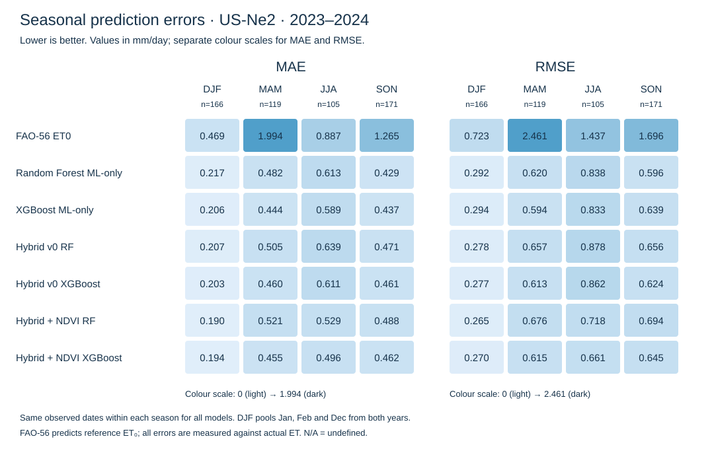

# Seasonal model comparison — US-Ne2, 2023–2024

All seven models use the same 561 canonical observed dates. No predictions are regenerated and no models are retrained or tuned.

## Protocol

DJF = December–February; MAM = March–May; JJA = June–August; SON = September–November. Dates are pooled by calendar month across both test years, not grouped into complete winters. Every available test date belongs to exactly one season; absent daily observations are not filled.

Metric definitions and the ET₀-versus-actual-ET limitation follow [the phase-3 report](fao56_ml_comparison.md). Pearson r² measures squared correlation; R² is the coefficient of determination and equals NSE. Positive bias means overestimation. MAE is the primary metric; all errors and deltas are in mm/day.

N/A (NaN in CSV) denotes an undefined metric. Empty groups have n=0; constant observations make Pearson r², R²/NSE and KGE undefined. Constant predictions make Pearson r² and KGE undefined; zero observed mean also makes KGE undefined. The CSV lists undefined_metrics explicitly.

## Seasonal errors



### DJF — n=166

| Model | n | MAE | RMSE | Pearson r² | R² | Bias | NSE | KGE |
|---|---:|---:|---:|---:|---:|---:|---:|---:|
| FAO-56 ET0 | 166 | 0.4686 | 0.7230 | 0.0896 | -2.7944 | 0.3383 | -2.7944 | -0.2854 |
| Random Forest ML-only | 166 | 0.2167 | 0.2924 | 0.3926 | 0.3794 | 0.0347 | 0.3794 | 0.4172 |
| XGBoost ML-only | 166 | 0.2063 | 0.2936 | 0.3771 | 0.3743 | 0.0152 | 0.3743 | 0.4285 |
| Hybrid + NDVI RF | 166 | 0.1896 | 0.2653 | 0.4925 | 0.4892 | -0.0057 | 0.4892 | 0.5372 |
| Hybrid + NDVI XGBoost | 166 | 0.1941 | 0.2695 | 0.4790 | 0.4728 | -0.0191 | 0.4728 | 0.5182 |
| Hybrid v0 RF | 166 | 0.2073 | 0.2780 | 0.4433 | 0.4391 | 0.0219 | 0.4391 | 0.5047 |
| Hybrid v0 XGBoost | 166 | 0.2028 | 0.2771 | 0.4462 | 0.4426 | 0.0165 | 0.4426 | 0.5001 |

### MAM — n=119

| Model | n | MAE | RMSE | Pearson r² | R² | Bias | NSE | KGE |
|---|---:|---:|---:|---:|---:|---:|---:|---:|
| FAO-56 ET0 | 119 | 1.9943 | 2.4613 | 0.0405 | -12.6658 | 1.9022 | -12.6658 | -1.5529 |
| Random Forest ML-only | 119 | 0.4815 | 0.6202 | 0.2977 | 0.1323 | 0.2118 | 0.1323 | 0.4545 |
| XGBoost ML-only | 119 | 0.4436 | 0.5940 | 0.3453 | 0.2041 | 0.1647 | 0.2041 | 0.5336 |
| Hybrid + NDVI RF | 119 | 0.5210 | 0.6762 | 0.2389 | -0.0316 | 0.1957 | -0.0316 | 0.4419 |
| Hybrid + NDVI XGBoost | 119 | 0.4552 | 0.6149 | 0.3179 | 0.1470 | 0.1578 | 0.1470 | 0.5225 |
| Hybrid v0 RF | 119 | 0.5047 | 0.6572 | 0.2321 | 0.0256 | 0.1736 | 0.0256 | 0.4307 |
| Hybrid v0 XGBoost | 119 | 0.4601 | 0.6128 | 0.3064 | 0.1529 | 0.1533 | 0.1529 | 0.5072 |

### JJA — n=105

| Model | n | MAE | RMSE | Pearson r² | R² | Bias | NSE | KGE |
|---|---:|---:|---:|---:|---:|---:|---:|---:|
| FAO-56 ET0 | 105 | 0.8868 | 1.4369 | 0.3147 | 0.0639 | 0.4538 | 0.0639 | 0.5442 |
| Random Forest ML-only | 105 | 0.6129 | 0.8375 | 0.7201 | 0.6820 | 0.1610 | 0.6820 | 0.8428 |
| XGBoost ML-only | 105 | 0.5886 | 0.8326 | 0.7287 | 0.6857 | 0.1582 | 0.6857 | 0.8450 |
| Hybrid + NDVI RF | 105 | 0.5287 | 0.7179 | 0.7836 | 0.7663 | 0.0815 | 0.7663 | 0.8833 |
| Hybrid + NDVI XGBoost | 105 | 0.4960 | 0.6611 | 0.8243 | 0.8019 | 0.1610 | 0.8019 | 0.8986 |
| Hybrid v0 RF | 105 | 0.6393 | 0.8775 | 0.7049 | 0.6509 | 0.0910 | 0.6509 | 0.8258 |
| Hybrid v0 XGBoost | 105 | 0.6114 | 0.8621 | 0.7072 | 0.6630 | 0.0839 | 0.6630 | 0.8338 |

### SON — n=171

| Model | n | MAE | RMSE | Pearson r² | R² | Bias | NSE | KGE |
|---|---:|---:|---:|---:|---:|---:|---:|---:|
| FAO-56 ET0 | 171 | 1.2649 | 1.6956 | 0.3356 | -0.5494 | 1.0790 | -0.5494 | 0.0671 |
| Random Forest ML-only | 171 | 0.4287 | 0.5957 | 0.8250 | 0.8088 | 0.1309 | 0.8088 | 0.8638 |
| XGBoost ML-only | 171 | 0.4369 | 0.6391 | 0.8210 | 0.7798 | 0.1635 | 0.7798 | 0.8285 |
| Hybrid + NDVI RF | 171 | 0.4884 | 0.6943 | 0.7904 | 0.7402 | 0.1899 | 0.7402 | 0.8058 |
| Hybrid + NDVI XGBoost | 171 | 0.4623 | 0.6446 | 0.8233 | 0.7760 | 0.1605 | 0.7760 | 0.8216 |
| Hybrid v0 RF | 171 | 0.4708 | 0.6564 | 0.7958 | 0.7678 | 0.1429 | 0.7678 | 0.8445 |
| Hybrid v0 XGBoost | 171 | 0.4606 | 0.6237 | 0.8153 | 0.7903 | 0.1139 | 0.7903 | 0.8642 |

## Hybrid minus ML-only

Negative differences mean improvement; positive differences mean worse performance. Comparisons use RF against RF and XGBoost against XGBoost on identical seasonal dates.

| Hybrid | ML-only reference | Season | n | ΔMAE | ΔRMSE |
|---|---|---|---:|---:|---:|
| Hybrid v0 RF | Random Forest ML-only | DJF | 166 | -0.0094 | -0.0144 |
| Hybrid v0 RF | Random Forest ML-only | MAM | 119 | +0.0232 | +0.0370 |
| Hybrid v0 RF | Random Forest ML-only | JJA | 105 | +0.0265 | +0.0400 |
| Hybrid v0 RF | Random Forest ML-only | SON | 171 | +0.0422 | +0.0607 |
| Hybrid v0 XGBoost | XGBoost ML-only | DJF | 166 | -0.0035 | -0.0165 |
| Hybrid v0 XGBoost | XGBoost ML-only | MAM | 119 | +0.0166 | +0.0188 |
| Hybrid v0 XGBoost | XGBoost ML-only | JJA | 105 | +0.0227 | +0.0295 |
| Hybrid v0 XGBoost | XGBoost ML-only | SON | 171 | +0.0237 | -0.0154 |
| Hybrid + NDVI RF | Random Forest ML-only | DJF | 166 | -0.0271 | -0.0271 |
| Hybrid + NDVI RF | Random Forest ML-only | MAM | 119 | +0.0395 | +0.0560 |
| Hybrid + NDVI RF | Random Forest ML-only | JJA | 105 | -0.0841 | -0.1196 |
| Hybrid + NDVI RF | Random Forest ML-only | SON | 171 | +0.0598 | +0.0987 |
| Hybrid + NDVI XGBoost | XGBoost ML-only | DJF | 166 | -0.0122 | -0.0241 |
| Hybrid + NDVI XGBoost | XGBoost ML-only | MAM | 119 | +0.0116 | +0.0209 |
| Hybrid + NDVI XGBoost | XGBoost ML-only | JJA | 105 | -0.0927 | -0.1715 |
| Hybrid + NDVI XGBoost | XGBoost ML-only | SON | 171 | +0.0254 | +0.0055 |

## Strongest and weakest seasons

Ranked within each model by absolute MAE, with RMSE shown for context. These are descriptive error rankings, not proof of greater relative skill: ET magnitude, variability and sample counts differ between seasons.

| Model | Lowest MAE season(s) | Highest MAE season(s) |
|---|---|---|
| FAO-56 ET0 | DJF: MAE 0.4686, RMSE 0.7230, n=166 | MAM: MAE 1.9943, RMSE 2.4613, n=119 |
| Random Forest ML-only | DJF: MAE 0.2167, RMSE 0.2924, n=166 | JJA: MAE 0.6129, RMSE 0.8375, n=105 |
| XGBoost ML-only | DJF: MAE 0.2063, RMSE 0.2936, n=166 | JJA: MAE 0.5886, RMSE 0.8326, n=105 |
| Hybrid + NDVI RF | DJF: MAE 0.1896, RMSE 0.2653, n=166 | JJA: MAE 0.5287, RMSE 0.7179, n=105 |
| Hybrid + NDVI XGBoost | DJF: MAE 0.1941, RMSE 0.2695, n=166 | JJA: MAE 0.4960, RMSE 0.6611, n=105 |
| Hybrid v0 RF | DJF: MAE 0.2073, RMSE 0.2780, n=166 | JJA: MAE 0.6393, RMSE 0.8775, n=105 |
| Hybrid v0 XGBoost | DJF: MAE 0.2028, RMSE 0.2771, n=166 | JJA: MAE 0.6114, RMSE 0.8621, n=105 |

## Hybrid findings

- Hybrid v0 RF, MAE: better than its ML-only counterpart in DJF; worse in MAM, JJA, SON; equal in none; undefined in none (unrounded differences).
- Hybrid v0 RF, RMSE: better than its ML-only counterpart in DJF; worse in MAM, JJA, SON; equal in none; undefined in none (unrounded differences).
- Hybrid v0 XGBoost, MAE: better than its ML-only counterpart in DJF; worse in MAM, JJA, SON; equal in none; undefined in none (unrounded differences).
- Hybrid v0 XGBoost, RMSE: better than its ML-only counterpart in DJF, SON; worse in MAM, JJA; equal in none; undefined in none (unrounded differences).
- Hybrid + NDVI RF, MAE: better than its ML-only counterpart in DJF, JJA; worse in MAM, SON; equal in none; undefined in none (unrounded differences).
- Hybrid + NDVI RF, RMSE: better than its ML-only counterpart in DJF, JJA; worse in MAM, SON; equal in none; undefined in none (unrounded differences).
- Hybrid + NDVI XGBoost, MAE: better than its ML-only counterpart in DJF, JJA; worse in MAM, SON; equal in none; undefined in none (unrounded differences).
- Hybrid + NDVI XGBoost, RMSE: better than its ML-only counterpart in DJF, JJA; worse in MAM, SON; equal in none; undefined in none (unrounded differences).

Results describe one station and two holdout years. Statistical significance and transferability are not established. Calendar seasons are not crop growth stages. The physical baseline estimates reference ET₀ without Kc, so its error includes target mismatch.

## Reproduction

```bash
PYTHONPATH=src python -m ml.evaluation.seasonal
```

Outputs: seasonal_metrics.csv, seasonal_deltas.csv, seasonal_dates.csv, seasonal_errors.svg and seasonal_comparison.md in reports/. seasonal_dates.csv is the shared date-to-season audit used by every model.
